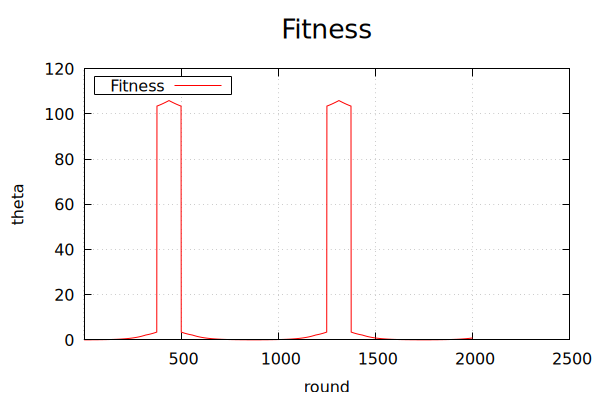

# UNR Project Zero

A from-scratch C++ framework for machine-learning **agents** that learn to control **domains**. Everything is hand-written with no ML libraries: a feed-forward neural network, a population-based evolutionary trainer, a Q-learner, and test environments like an inverted pendulum on a cart and a multi-armed bandit.

The core idea is a clean **agent ↔ domain** loop:

1. Create the agent(s) and the domain.
2. Each round, the domain sends its **state** to the agent.
3. The agent replies with an **action**.
4. The domain scores the result and returns a **fitness**.

A **trainer** sits on top of that loop. It runs a population of agents through the domain, keeps the fittest, mutates them, and repeats.



---

## Components

### Agents (`agents/`)
- **Neural network** (`agents/neural_network/network/neural_network.h`): a feed-forward network built from `Node` → `Layer` → `Network`, with configurable nodes per layer, weight mutation (mutation size and chance) and weight import/export.
- **Network trainer v3.0** (`agents/neural_network/trainer_3_0/`): an evolutionary trainer that evolves a population of 100 networks on the cart-balance domain by scoring, pruning, repopulating and mutating them. It logs fitness history, saves the best network (`best_network.bin`), and plots the results with gnuplot.
- **Q-learner** (`agents/q_learner/`): a tabular Q-learning agent for the grid domain (work in progress).
- Older trainer and network versions are kept in `_complete/` and `_outdated/`.

### Domains (`domains/`)
- **Cart balance**, an inverted pendulum on a cart: keep the pendulum upright by pushing the cart along a finite track. Written by Sierra Gonzales ([sierra121314](https://github.com/sierra121314)) and included here with credit, which is why it lives in `_not_mine/`.
- **Multi-armed bandit**: a row of slot machines with hidden biases, for exploration-versus-exploitation experiments. Sample output is in `mab_results.txt`.
- **Gridspace**: a 2D grid world for the Q-learner.
- **Dummy domain**: generates random inputs with a known target function, for testing the network and trainer.

### System (`system/`)
The unified version that ties it all together:
- `system.hpp` manages the agent ↔ domain interaction.
- `agent/neural_network.hpp` is the agent, `domain/pendulum.hpp` is the inverted pendulum domain (by Sierra Gonzales), and `improvement_algorithm/evoutionary_algorithm.hpp` is the trainer.
- `main.cpp` picks a run type: normal (1) or train (2).
- `_gui/` is a Qt desktop front end (work in progress). Its System tab picks the agent and domain, sets max rounds, starts, pauses and exports runs, and shows best/average fitness and progress. A Data tab plots the results with QCustomPlot.
- `resources/` holds design notes and XMind maps of the system, communication plan, network, trainer and domain.

<p align="center">
  
  
</p>

---

## Building and running

You need `g++` with C++11 and `gnuplot` for the graphs. The GUI also needs Qt.

**Evolve a network for cart balance (trainer v3.0):**

```bash
cd agents/neural_network/trainer_3_0
make
./run
gnuplot outputs/graph_all.gnu
```

**Run the cart balance domain on its own:**

```bash
cd domains/_not_mine/cart_balance
./go.sh   # builds, runs, and plots theta, position, force, torque and fitness
```

**Multi-armed bandit example:**

```bash
cd domains/multi_armed_bandit
make
./run
```

**Unified system:**

```bash
cd system/source
make system
./run
```

**GUI:** open `system/_gui/source/vs_1/System.pro` in Qt Creator.

---

## Status

This is a long-running personal project that started in 2016–2017 and was picked back up in 2025.
- The neural network, trainer v3.0 and cart-balance domain work, and the most recent changes are there (cart force, graphs).
- The unified `system/` code, the Qt GUI and the Q-learner are work in progress.

## Credits

- **Cart balance / pendulum domain:** Sierra Gonzales ([sierra121314](https://github.com/sierra121314)).
- **QCustomPlot** (used in the GUI): Emanuel Eichhammer, GPL v3.
- Everything else is original work.
