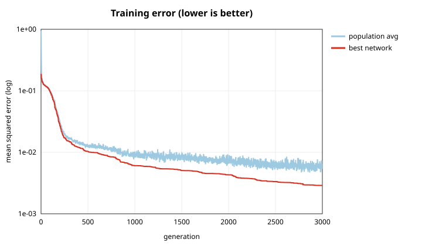
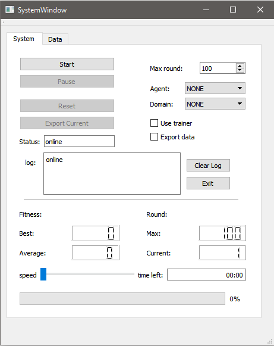
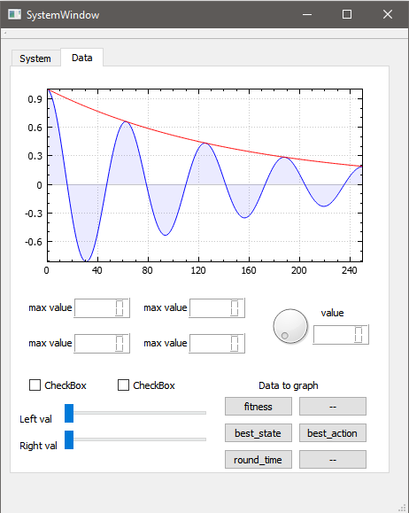

# UNR Project Zero

A from-scratch C++ framework for machine-learning **agents** that learn to control **domains**. Everything is hand-written with no ML libraries: a feed-forward neural network, a population-based evolutionary trainer, a Q-learner, and test environments like an inverted pendulum on a cart and a multi-armed bandit.

The core idea is a clean **agent ↔ domain** loop:

1. Create the agent(s) and the domain.
2. Each round, the domain sends its **state** to the agent.
3. The agent replies with an **action**.
4. The domain scores the result and returns a **fitness**.

A **trainer** sits on top of that loop. It runs a population of agents through the domain, keeps the fittest, mutates them, and repeats.



*The v3.0 neural network (1-8-8-1, tanh) evolved to approximate sin(x) on [-π, π] (mean squared error over 64 points), with this branch's improved settings. With seed 1 the best network's error falls from 0.14 to 0.00057 in 3,000 generations (population 100).*

---

## Branch progress

### This branch: `sine-improvements`

**Progress: the sine model and its training, tuned and measured.** On top of `sine-trainer`, every trainer setting is now a command-line option. A sweep of 13 configurations × 5 seeds found:
- **Three changes together cut the final error 8.6×** (median 0.0041 → 0.00047) and make runs far more consistent:
  - a second hidden layer (1-8-8-1)
  - smaller, more frequent mutations
  - shrinking the mutation size over the run
- These are now the defaults. Seed 1 goes from 0.14 to **0.00057**.
- **Elitism matters:** without it, results are 1.5× worse. Trainer v3.0 doesn't use it yet.
- **Network size isn't the limit:** gradient descent on the same 1-8-1 network reaches 0.00004, about 100× lower than evolution.

Full write-up: [IMPROVEMENTS.md](agents/neural_network/sine_trainer/IMPROVEMENTS.md).

**Next:** [`cart-trainer`](https://github.com/wjhdfnmf/ProjectZero/tree/cart-trainer) applies these lessons to cart balance.

### All branches

Each branch builds on the one before it, so the latest branch has everything.

| Branch | Builds on | What it adds | Headline result |
|---|---|---|---|
| [`main`](https://github.com/wjhdfnmf/ProjectZero/tree/main) | — | The framework: the v3.0 neural network, trainer v3.0, cart balance, multi-armed bandit, grid world, the unified `system/` and the Qt GUI. Also the fix for random selection in the trainer. | Baseline |
| [`sine-trainer`](https://github.com/wjhdfnmf/ProjectZero/tree/sine-trainer) | `main` | A **sine-wave trainer**: evolves the v3.0 network to fit sin(x), with SVG plots. | 1-8-1 network: error 0.0029 after 3,000 generations |
| **`sine-improvements` (this branch)** | `sine-trainer` | **Better sine training**: configurable settings, a sweep of 13 configurations × 5 seeds, a gradient-descent baseline, and the best settings as the new defaults. | **8.6×** lower error (median 0.0041 → 0.00047) |
| [`cart-trainer`](https://github.com/wjhdfnmf/ProjectZero/tree/cart-trainer) | `sine-improvements` | A **cart-balance trainer** and report. Optional fixes to the cart-balance domain close the loophole where the cart drives off its track (the original problem is unchanged when they're off). | Balanced from **all 19** start angles from 45° to 135° (best seed) |
| [`gpu-network`](https://github.com/wjhdfnmf/ProjectZero/tree/gpu-network) | `cart-trainer` | **GPU neural network v4** (CUDA): whole populations evolved on the GPU with a GA or Evolution Strategies, and a new problem, **Booster Landing** (easy and hard mode). | **16,000×** faster than v3; **96.3%** of hard-mode landings |
| [`gpu-network-v2`](https://github.com/wjhdfnmf/ProjectZero/tree/gpu-network-v2) | `gpu-network` | A faster warp kernel; a realistic **real mode**; transfer learning; a **3D visualizer** with video export; weight paintings; **G-FOLD** (a convex-optimization flight computer); and landing-speed and landing-gate scoring experiments. | Real-mode flagship **85.5%**; G-FOLD alone 26.1% |

---

## Components

### Agents (`agents/`)
- **Neural network** (`agents/neural_network/network/neural_network.h`): a feed-forward network built from `Node` → `Layer` → `Network`, with configurable nodes per layer, weight mutation and weight import/export. See the [deep dive](#deep-dive-the-neural-network-agent) below.
- **Network trainer v3.0** (`agents/neural_network/trainer_3_0/`): an evolutionary trainer that evolves a population of 100 networks on the cart-balance domain. It logs fitness history, replays the best network, and plots the results with gnuplot.
- **Sine trainer** (`agents/neural_network/sine_trainer/`): evolves the v3.0 network to approximate sin(x), with SVG plots and an improvements report ([IMPROVEMENTS.md](agents/neural_network/sine_trainer/IMPROVEMENTS.md)).
- **Q-learner** (`agents/q_learner/`): a tabular Q-learning agent for the grid domain (work in progress).
- Older trainer and network versions are kept in `_complete/` and `_outdated/`.

### Domains (`domains/`)
- **Cart balance**, an inverted pendulum on a cart: keep the pendulum upright by pushing the cart along a finite track. Written by Sierra Gonzales ([sierra121314](https://github.com/sierra121314)) and included here with credit, which is why it lives in `_not_mine/`.
- **Multi-armed bandit**: a row of slot machines with hidden biases, for exploration-versus-exploitation experiments. Sample output is in `mab_results.txt`.
- **Gridspace**: a 2D grid world for the Q-learner.
- **Dummy domain**: generates random inputs with a known target function, for testing the network and trainer.

### System (`system/`)
The unified version that ties it all together:
- `system.hpp` manages the agent ↔ domain interaction.
- `agent/neural_network.hpp` is the agent, `domain/pendulum.hpp` is the inverted pendulum domain (by Sierra Gonzales), and `improvement_algorithm/evoutionary_algorithm.hpp` is the trainer.
- `main.cpp` picks a run type: normal (1) or train (2).
- `_gui/` is a Qt desktop front end (work in progress). Its System tab picks the agent and domain, sets max rounds, starts, pauses and exports runs, and shows best/average fitness and progress. A Data tab plots the results with QCustomPlot.
- `resources/` holds design notes and XMind maps of the system, communication plan, network, trainer and domain.

<p align="center">
  
  
</p>

---

## Deep dive: the neural network agent

The agent is a small fully connected feed-forward network trained by **neuroevolution**: there's no backpropagation and no gradients. Networks are scored on the cart-balance domain, and the better ones are copied and randomly mutated. The network lives in `agents/neural_network/network/neural_network.h` and the trainer in `agents/neural_network/trainer_3_0/network_trainer.h`.

### 1. Structure: `Node` → `Layer` → `Network`

The trainer builds a **3 → 4 → 2** network:

```
   INPUT (3 + bias)          HIDDEN (4 + bias)          OUTPUT (2)

   cos θ  ──┐               ┌── h1 ──┐
   sin θ  ──┼── weights ────┼── h2 ──┼── weights ──┬── torque  (× max_torque)
   θ̇      ──┤   (all to all)├── h3 ──┤  (all to all)└── force   (× max_force)
   bias=1 ──┘               ├── h4 ──┤
                            └─ bias=1┘
```

- **Layer sizes** are passed as a nodes-per-layer list (`{3, 4, 2}`). `add_bias()` adds a bias node to every layer except the output, so internally the network is `{4, 5, 2}`.
- **Each node stores its outgoing weights**, one per node in the next layer. The `Network` holds `Layer`s, each `Layer` holds `Node`s, and each `Node` holds `std::vector<double> weights`.
- **Bias nodes** always output `1.0`, regardless of their input. This gives each downstream node a learnable offset.
- **Output nodes have no weights.** Their single value is the network's output.

### 2. Forward pass (`Network::cycle`)

1. **Input layer.** `format_input()` appends `1.0` for the bias node. Each input node passes its value through unchanged, with no activation, then multiplies it by each outgoing weight.
2. **Hidden and output layers.** `Layer::cycle` transposes the previous layer's outputs so that node *j* receives the *j*-th weighted value from every node before it. Each node sums its inputs and applies **`tanh`**. A sigmoid is still in the code, commented out.
3. **Output.** The output layer's values, each in `[-1, 1]`, are collected into a plain vector.

In equation form, for node *j* in layer *l*:

```
a_j(l) = tanh( Σ_i  w_ij(l-1) · a_i(l-1) )      where the bias node has a = 1
```

### 3. Initialization

Each weight starts as a random magnitude in `[0, 1]` with a random sign (50/50), so initial weights fall in `[-1, 1]`.

### 4. Mutation (`Node::mutate`)

Every weight in the network gets an independent chance to mutate:

```
with probability  mutate_chance (0.1):
    w  ←  w + U(0, mutate_mod) − U(0, mutate_mod)        mutate_mod = 0.2
```

Subtracting two uniform samples gives a **triangular** step centered on zero within `±0.2`. Small tweaks are common and large ones are rare. There's no crossover; offspring are mutated copies of a single parent.

### 5. How the agent sees and acts on the domain

| | Value | Notes |
|---|---|---|
| **Inputs** | `cos θ`, `sin θ`, `θ̇` | θ is the pendulum angle in radians, with upright = 90° (π/2). Encoding the angle as cos/sin avoids the jump where 359° wraps to 0°. |
| **Output 1** | torque = `tanh(…) × max_torque` | `max_torque = 0` in trainer v3.0, so torque is **off**. |
| **Output 2** | force = `tanh(…) × max_force` | `max_force = 40 N`, pushing the cart left or right. |

The domain clamps both actions to their limits, steps the physics (`dt = 0.1 s`), and returns a **cost** (lower is better):

| Term | Weight | Penalizes |
|---|---|---|
| Angle error from upright | 100 | Leaning away from 90° |
| Angular velocity | 1000, then capped and normalized to 0–1 | Any swinging |
| Below horizontal | +10 | The pendulum falling past horizontal |
| Torque used, wrong direction, integrated error | 0 | Present but turned off |

### 6. Training loop (`Trainer::train`)

Starting setup: 100 random networks, the pendulum at **θ = 95°** (5° off upright), a 1 kg / 1 m pendulum on a 2 kg cart, and a 10 m track.

Each **round** (generation), repeated `round_max = 1000` times:

1. **Evaluate.** Each network gets a fresh pendulum and controls it for `test_count = 200` steps (20 s of simulated time). Its fitness is the cost averaged over those steps. Every network starts from the same state; there's no randomness in the domain.
2. **Record** (`error_manager`). Track the best network ever seen and the round's best fitness, and append every network's fitness to `fitness_history`.
3. **Select** (`prune`). Run 50 two-network tournaments: pick two networks at random and keep the one with the lower cost. A network can win more than once.
4. **Refill** (`populate`). Copy random survivors, mutate the copies, and add them until the population is back to 100.

After training, `run_best_network()` replays the best network on a fresh pendulum and exports every state to CSV. `outputs/graph_all.gnu` then plots angle, position, force, torque and fitness.

### 7. Things worth knowing about the current code

- **There's no elitism.** The best network is tracked and replayed at the end, but it isn't guaranteed a place in the next generation. It survives only if it wins a tournament.
- **Fixed: selection used to be random.** Earlier versions reset `pop_fitness` to zero inside `error_manager()`, *before* `prune()` ran, so every tournament compared 0 to 0. The reset now happens in `train()` after `populate()`, so tournaments compare the real scores.
- **The best network isn't saved to disk.** The code that would write `best_network.bin` is commented out in `run_best_network()`, so the `.bin` in the repo is from an earlier run.
- **Some weights do nothing.** Each node also gets a weight to the next layer's bias node, but bias nodes ignore their input. In the 3-4-2 network, 4 of the 30 weights have no effect.
- **The range settings aren't used.** `weight_gen_min` and `weight_gen_max` are set to −1 and 1 but never read. The actual range is the same anyway.

---

## Building and running

You need `g++` with C++11 and `gnuplot` for the graphs. The GUI also needs Qt.

**Evolve a network for cart balance (trainer v3.0):**

```bash
cd agents/neural_network/trainer_3_0
make
./run
gnuplot outputs/graph_all.gnu
```

**Sine trainer:**

```bash
cd agents/neural_network/sine_trainer
make
./run 1
python plot.py
```

**Run the cart balance domain on its own:**

```bash
cd domains/_not_mine/cart_balance
./go.sh   # builds, runs, and plots theta, position, force, torque and fitness
```

**Multi-armed bandit example:**

```bash
cd domains/multi_armed_bandit
make
./run
```

**Unified system:**

```bash
cd system/source
make system
./run
```

**GUI:** open `system/_gui/source/vs_1/System.pro` in Qt Creator.

---

## Status

This is a long-running personal project that started in 2016–2017 and was picked back up in 2025.
- The neural network, trainer v3.0 and cart-balance domain work, and the most recent changes are there (cart force, graphs).
- The unified `system/` code, the Qt GUI and the Q-learner are work in progress.
- **This branch** adds the tuned sine trainer and its improvements report (see [Branch progress](#branch-progress)).

## Credits

- **Cart balance / pendulum domain:** Sierra Gonzales ([sierra121314](https://github.com/sierra121314)).
- **QCustomPlot** (used in the GUI): Emanuel Eichhammer, GPL v3.
- Everything else is original work.
