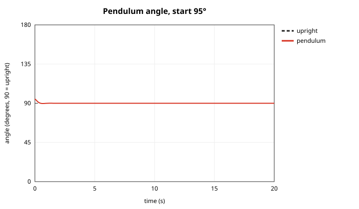
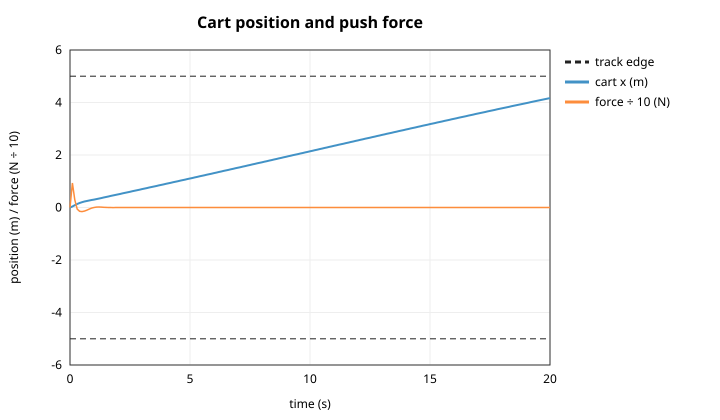
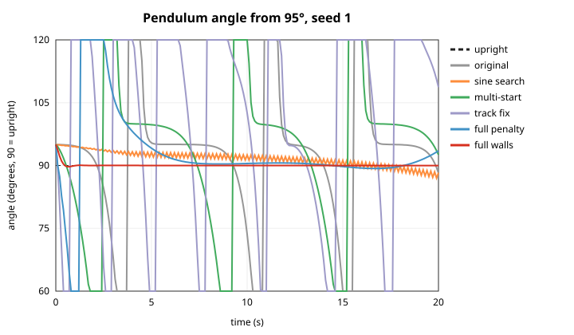
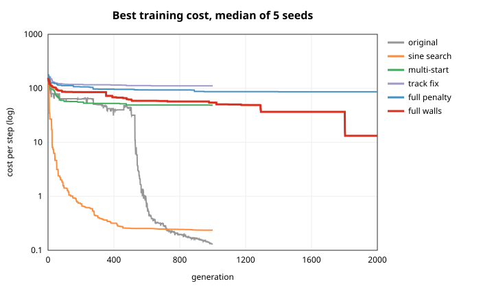

# Cart balance: training report

**Bottom line:** the evolved network can balance the pendulum almost perfectly. The default setup holds it within **0.02° of upright** from a 95° start, and keeps it upright from **all 19 start angles between 45° and 135°**. Getting there took two discoveries.

1. **The original setup has a loophole.** The network can't see the cart, and the domain never enforces its 10 m track. So the best controllers balance the pendulum while the cart rolls away: up to **129 m** in 20 s with trainer_3_0's own settings.
2. **Fixing the loophole makes the problem much harder.** Letting the network see the cart, penalizing leaving the track, and stopping the cart at the track ends (a new, optional domain feature) solved it in 1 of 5 seeds from every start angle. A further 2 seeds solved it from some angles. Results swing a lot by seed, so running several seeds and keeping the best is part of the recipe.

```bash
./run 1      # defaults = the best full-problem setup; seed 1 reproduces everything below
```

<p align="center">
  
  
</p>

*Default settings, seed 1, starting at 95°. Left: the pendulum is upright within about 2 s and stays there. Right: the cart drifts slowly (0.19 m/s at the end) but stays on the track, and the push force settles to almost zero.*

---

## The task

| | |
|---|---|
| **Domain** | Cart Balance by Sierra Gonzales ([sierra121314](https://github.com/sierra121314)): a 1 kg, 1 m pendulum on a 2 kg cart, a 10 m track, `dt = 0.1 s`, and pushes up to ±40 N (torque is disabled). These are the same settings as trainer_3_0. |
| **Episode** | 200 steps (20 s), starting at 95° (5° from upright) unless noted. |
| **Network** | Neural Network v3.0. Inputs are `cos θ`, `sin θ` and `θ̇`, plus cart position and velocity with `cartin=1`. Outputs are torque and force. |
| **Cost** | The domain's own per-step cost (lower is better). It's mostly the angle error, plus +1 whenever the pendulum is moving and +10 when it's below horizontal. With `track=1`, the trainer adds +10 per step at or past the track end. |
| **Evolution** | The trainer_3_0 loop (tournament keeps 50 of 100, then mutated copies refill the population) with the selection bug fixed. |
| **Evaluation** | The best network is tested from every start angle from 45° to 135° in 5° steps (19 starts, most never seen in training). **Upright** means it never fell below horizontal and ended within 10° of upright. **Balanced** means upright *and* the cart stayed within ±5 m. |

Every configuration ran for seeds 1–5 (`./experiments.sh`). Runs are deterministic per seed.

## Results

| Config | What changed | Cost from 95° (median) | Cart drift from 95° (median) | Upright /19 (per seed) | **Balanced /19** (per seed) |
|---|---|---|---|---|---|
| original | trainer_3_0's settings: 3-4-2, `chance .1 mod .2`, no elitism, 1,000 gens | 0.13 | 4.2 m | 0, 19, 0, 19, 19 | 0, 3, 0, 3, 3 |
| sine search | the sine task's best mutation settings + elitism | 0.24 | 6.0 m | 1, 0, 19, 18, 19 | 0, 0, 3, 1, 3 |
| multi-start | + train from 80°, 85°, 95° and 100° | 41.7 | 52 m | 0, 0, 0, 13, 19 | 0, 0, 0, 1, 3 |
| track fix | + network sees the cart, track penalty | 106 | 4.8 m | all 0 | all 0 |
| track fix 8-8 | same, 3-8-8-2 network | 91.3 | 4.5 m | all 0 | all 0 |
| full penalty | original mutation + elitism, sees the cart, track penalty, 1 start, 2,000 gens | 77.1 | 5.8 m | 0, 0, 0, 19, 0 | 0, 0, 0, **8**, 0 |
| **full walls (default)** | full penalty + **domain track walls** | **7.49** | 5.0 m | **19**, 0, 4, 0, 4 | **19**, 0, 4, 0, 4 |
| full penalty, 8 hidden | full penalty with a 3-8-2 network | 89.3 | 2.4 m | all 0 | all 0 |



*Seed 1 of each configuration, starting at 95°. Angles are clipped to 60°–120°.*

### Finding 1: "balanced" was really "balanced while driving away"
With trainer_3_0's settings, 3 of 5 seeds keep the pendulum upright from every start angle, to within a thousandth of a degree. But the cart drifts at a constant speed the whole time. From 135° it ends up **129 m** away on a 10 m track, and from 45° it ends up 91 m away. Only the 3 starts nearest upright (85°–95°) stay on the track.

That isn't a training failure. The network has no way to know where the cart is, and nothing in the domain stops or penalizes it. The early-training exploit is even more blatant: holding the pendulum at a steady tilt by accelerating the cart forever (seen in a 20-generation test).

### Finding 2: what worked for the real problem
To balance on the track, the controller needs to **see the cart** (`cartin=1`), and leaving the track has to **cost something** (`track=1`). Even with both, 4 of 5 seeds got stuck with the pendulum swinging. The setup that worked best also turned on the domain's new **track walls** (`walls=1`), which stop the cart at ±5 m instead of letting it roll off:

- **Seed 1** balances from all 19 starts. It holds within 0.02° of upright from 95° without ever touching a wall. From the 12 starts furthest from upright, the cart does reach a wall, and the pendulum still recovers.
- **Seeds 3 and 5** balance from 4 starts each.
- **Without walls**, only seed 4 ("full penalty") succeeded, balancing on the track from 8 of 19 starts.

A likely reason walls help: the cart can't leave the track, so a near-miss costs a bump against the wall instead of the whole run. That gives evolution a smoother path to the solution. *This explanation isn't tested directly.*

### Finding 3: the sine task's tuning didn't transfer
The settings that cut error 8.6× on the sine task did *not* help here, and annealing hurt. Cart balance has large stuck regions in the cost (the "swinging" and "driving away" solutions). Shrinking the step size makes it harder to escape them. A larger, fixed mutation step with elitism worked best.

### Finding 4: results depend heavily on the seed
Every configuration is bimodal: a seed either finds a balancing controller early or plateaus within about 100–500 generations and never recovers. For example, trainer_3_0's settings with seed 1 sit at cost 76 for 900 generations, while seed 5 reaches 0.3 by generation 100 and 0.1 by generation 500. More generations don't rescue a stuck run. **Several short runs, keeping the best, beat one long run.**



*Median best training cost by configuration. The track configurations include the track penalty, so compare them with each other rather than with the first three.*

---

## Improvements to Sierra's domain

All of these changes are in `domains/_not_mine/cart_balance/cart_balance.h`. With the new options left off, the original problem is unchanged. I checked this by rerunning two configurations (`original` and `track_fix`, seed 1) against the old header: `fitness.csv`, `rollout.csv`, `eval.csv` and `weights.txt` were all **byte-for-byte identical**. `trainer_3_0` and the domain's own `main.cpp` still compile.

| Change | Why |
|---|---|
| Read-only accessors: `pend_state()`, `cart_state()`, `last_force()`, `last_torque()` | Controllers and loggers couldn't see the cart's position, so this trainer had to hack its way into private members to get it. |
| `export_all_states(path)`, default `outputs/pend_state_log.csv` | It used to write to a hard-coded `/home/boss/...` path and failed on any other machine. |
| Optional `set_track_walls(true)` | Stops the cart at the track ends (±track/2) and zeroes its velocity. It's off by default. |
| `3/2*M_PI` → `3.0/2*M_PI` in `delta_theta` | Integer division made it π instead of 3π/2. The wrap-around check below it already gave the right answer, so results are unchanged; it's just clearer now. |
| Skip the position-error integral when its weight is 0 | It scanned the entire history on every step, which is wasted work at the default weight of 0. |

**Left alone on purpose:** the angle cost is written `delta / 2 * M_PI * 100`, which C++ evaluates as `(delta / 2) * π * 100`. It was probably meant to be `delta / (2π) * 100`. As written, the angle term is about 10× (π²) larger relative to the other terms than the function's comment says. Fixing it would change the problem, so it stays as is.

## Recommendations

1. **Use the defaults, with several seeds.** `./run <seed>` for seeds 1–10, then keep the run with the most balanced starts in `eval.csv`.
2. **Optional: penalize cart speed or position in the cost.** Even the best controller drifts at 0.19 m/s. A small cost on `|x|` or `|ẋ|` would teach it to stop the cart. This changes the problem, so it should be an opt-in weight, like the existing unused `pi_weight`.
3. **Restart stuck runs automatically.** Runs that haven't improved in about 300 generations almost never recover. Restarting them with new random weights would make the setup much less dependent on the seed.
4. **Train from more start angles after getting a working controller.** Multi-start training from scratch made things worse within 1,000 generations, but fine-tuning an already-balancing network from several start angles should help it generalize.
5. **Evaluate the population in parallel.** Networks are independent, so spreading them across 24 CPU threads should cut a 2,000-generation run from about 80 s to well under 10 s. *Not measured.*

## Caveats

- **5 seeds per configuration, and results are bimodal**, so the medians move a lot with one seed. Read the per-seed columns.
- **The full-problem configs ran 2,000 generations, the others 1,000.** The track configs had plateaued well before 1,000 (see the training cost plot), so the extra generations weren't what made the difference.
- **Run times are noisy.** Runs shared a 24-core machine. A single default run alone takes about 80 s.
- **"Balanced" means at the end of 20 s.** The best controller would reach a wall a few seconds after that, at its current drift.
