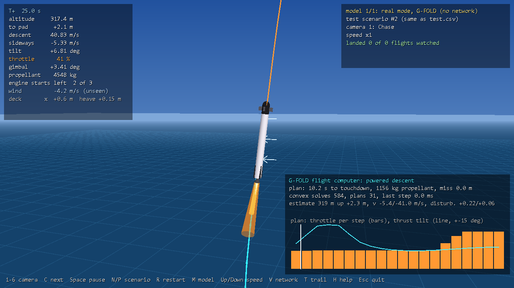
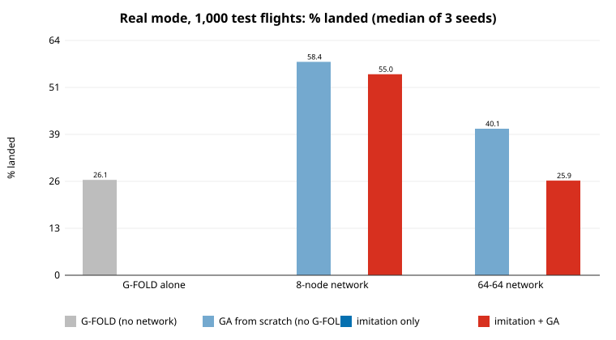

# G-FOLD: a convex-optimization flight computer for Booster Landing

**G-FOLD** (Guidance for Fuel-Optimal Large Diverts) is the powered-descent guidance algorithm developed at NASA JPL by Behçet Açıkmeşe, Lars Blackmore and colleagues. It was flight-tested on Masten's Xombie rocket in 2012–2013, and the same family of methods (convex optimization solved on board, many times per second) is how reusable boosters are guided to their landing pads today.

Its key idea: landing a rocket with the least propellant looks like a hard, non-convex problem, but it can be **rewritten exactly as a convex one**. A convex problem has a single best answer, a solver finds it reliably in milliseconds, and when there is no answer the solver can say so. That makes it safe to run on a flight computer.

This page covers:
1. what G-FOLD computes, and how its output flies the booster,
2. the math,
3. how it was implemented here (`gfold.h`, `gfold.cu`), with no libraries,
4. results: G-FOLD alone, the neural networks alone, and networks that learn from G-FOLD.

---

## 1. Inputs and outputs

**G-FOLD flies the booster through the same interface as the neural network.** It receives the same 12 noisy, delayed sensor values each 0.05 s step (`rocket::make_input`), and must return the same two commands. It never sees the wind, the true state or the scenario.

| | |
|---|---|
| **Inputs (every 0.05 s)** | position and velocity relative to the deck, tilt and rotation rate, propellant, deck velocity (sideways and vertical), actual throttle, engine starts left. Real mode: noisy and 0.1 s late. |
| **Outputs (every 0.05 s)** | throttle (0, or 40–100%) and engine gimbal angle (±8.6°) |
| **Inside** | a state estimator, a phase sequencer, the G-FOLD planner (a convex optimization, re-solved twice a second), and a tracking controller that turns the plan into throttle and gimbal |

```
 sensors (12, noisy, late) ──► estimator ──► state now + disturbance estimate
                                                │
               ┌────────────────────────────────┤
               ▼                                ▼
     phase sequencer                  G-FOLD planner (convex SOCP)
  stabilize → coast → burn → terminal    "fuel-optimal thrust profile
               │                          from here to the pad"
               ▼                                │ thrust-acceleration vector u(t)
       tracking controller ◄────────────────────┘
   (thrust vector → tilt command → gimbal, |u|·m → throttle)
               │
               ▼
     throttle, gimbal  ──► rocket.cuh physics
```

---

## 2. The math

### 2.1 The real problem (non-convex)

Treat the booster as a point mass $m$ at position $\mathbf r = (x, y)$ relative to the pad, with velocity $\mathbf v$ and engine thrust vector $\mathbf T$. During a burn of length $t_f$:

$$\dot{\mathbf r} = \mathbf v, \qquad \dot{\mathbf v} = \frac{\mathbf T}{m} + \mathbf g + \mathbf a_{\text{ext}}, \qquad \dot m = -\frac{\|\mathbf T\|}{I_{sp} g_0}$$

where $\mathbf a_{\text{ext}}$ is drag plus any known disturbance. The goal is to **minimize propellant**, $m(0) - m(t_f) = \int_0^{t_f} \|\mathbf T\| / (I_{sp} g_0)\, dt$, subject to:

| Constraint | Meaning | Booster Landing values |
|---|---|---|
| $\rho_1 \le \|\mathbf T\| \le \rho_2$ | the engine can't throttle below its minimum once lit | 40%–100% of 600 kN (plans use 42%–85% to leave margin) |
| $\mathbf T$ within $\theta_{\max}$ of vertical | the booster can only tilt so far | 15° (plans) |
| $y \ge \tan(\gamma)\,|x|$ | glide slope: stay above a cone around the pad | 30° |
| $m(t) \ge m_{\text{dry}}$ | can't burn more propellant than there is | 20 t dry |
| $\mathbf r(t_f) = 0,\ \mathbf v(t_f) = (0, -0.5)$ | arrive on the pad, nearly at rest | |

Two things make this non-convex:
1. **$\|\mathbf T\| \ge \rho_1$** is a non-convex set: a ring, not a disk. Any engine that can't throttle to zero has it.
2. **$\mathbf T/m$ with $m$ changing** makes the dynamics nonlinear.

### 2.2 Change of variables

Divide everything by mass. Let $\mathbf u = \mathbf T/m$ (thrust acceleration), $\sigma = \|\mathbf T\|/m$, and $z = \ln m$. Then

$$\dot{\mathbf v} = \mathbf u + \mathbf g + \mathbf a_{\text{ext}}, \qquad \dot z = \frac{\dot m}{m} = -\frac{\sigma}{v_e}, \qquad v_e = I_{sp} g_0$$

**The dynamics are now linear** in $(\mathbf r, \mathbf v, z, \mathbf u, \sigma)$. Propellant used is $m_0(1 - e^{-\int \sigma / v_e})$, which is monotonic in $\int \sigma\,dt$, so minimizing $\int \sigma\,dt$ minimizes propellant.

### 2.3 Lossless convexification

Replace the equality $\sigma = \|\mathbf u\|$ with the inequality

$$\|\mathbf u\| \le \sigma$$

and put the thrust limits on $\sigma$ instead: $\rho_1 e^{-z} \le \sigma \le \rho_2 e^{-z}$.

$\|\mathbf u\| \le \sigma$ is a **second-order cone** (an "ice-cream cone" in $(\sigma, u_x, u_y)$), which is convex. The ring has been filled in: the relaxed problem would allow $\|\mathbf u\| < \sigma$, which means paying for thrust you don't produce.

**The theorem (Açıkmeşe & Ploen, 2007):** at the optimum of the relaxed problem, $\|\mathbf u\| = \sigma$ holds everywhere along the trajectory, under mild conditions. Wasting thrust is never optimal, so the optimizer never does it. **The relaxation is lossless:** solving the easy convex problem gives the exact answer to the hard one.

### 2.4 Linearizing the thrust bounds

$\rho_1 e^{-z} \le \sigma \le \rho_2 e^{-z}$ still has $e^{-z}$. G-FOLD linearizes it around $z_0(t) = \ln(m_0 - \rho_2 t / v_e)$, the mass if the engine had run at full thrust so far, which is the lowest mass possible at time $t$:

$$\sigma \le \rho_2 e^{-z_0}\big(1 - (z - z_0)\big), \qquad \sigma \ge \rho_1 e^{-z_0}\big(1 - (z - z_0)\big)$$

Because $e^{-z}$ is convex, its tangent line lies below it. So the upper bound becomes slightly **stricter** than the true limit (safe), and the lower bound slightly looser. The tracking controller clips throttle to 40% anyway. Mass is also bounded between the full-thrust and minimum-thrust histories: $z_0(t) \le z(t) \le \ln(m_0 - \rho_1 t / v_e)$.

### 2.5 The remaining constraints are linear or conic

- **Pointing:** $u_y \ge \cos(\theta_{\max})\,\sigma$ (linear, because $\sigma \ge \|\mathbf u\|$).
- **Glide slope:** $y \ge \tan(\gamma)\,|x|$ becomes two linear inequalities.
- **Thrust-rate limits** (added here, see 4.2): $|u_{x,k+1} - u_{x,k}| \le \dot u_x^{\max} h$, and the same for $u_y$. These are linear.
- **Final approach:** in the last 3 s, $|u_x| \le \tan(4°)\,u_y$ (thrust near vertical for touchdown). This is linear.
- **First step:** $\mathbf u_0$ must be near the thrust the engine produces now. This is linear.

### 2.6 Discretization

Split the burn into $N$ steps of length $h = t_f / N$ ($N = 20$, fewer for short burns), with $\mathbf u_k$ and $\sigma_k$ constant over step $k$ (zero-order hold). Integrating exactly over one step gives:

$$\mathbf v_{k+1} = \mathbf v_k + h(\mathbf u_k + \mathbf g + \mathbf a_k), \qquad \mathbf r_{k+1} = \mathbf r_k + h \mathbf v_k + \tfrac{h^2}{2}(\mathbf u_k + \mathbf g + \mathbf a_k), \qquad z_{k+1} = z_k - \frac{h}{v_e}\sigma_k$$

**Drag** depends on velocity, which is non-convex. Here it's evaluated beforehand on a straight-line reference velocity profile (from the current velocity to the touchdown velocity), giving a known $\mathbf a_k$ per step.

**The result is a second-order cone program (SOCP):** about 185 variables and 330 constraints, of which 20 are cones.

$$\min_{\mathbf r, \mathbf v, z, \mathbf u, \sigma} \sum_k h\,\sigma_k \quad \text{s.t. linear dynamics, } \|\mathbf u_k\| \le \sigma_k, \text{ linear bounds}$$

### 2.7 Free final time and ignition time

The burn length $t_f$ is not known in advance. With $t_f$ fixed the problem is convex, and the optimal propellant as a function of $t_f$ is well behaved. So G-FOLD **searches $t_f$**: here a scan of 9 values plus a golden-section refinement.

Ignition time is searched the same way, one level up. Every 0.5 s during the coast, the computer predicts where the booster will be 1 s later (coasting with drag), and asks the solver whether a landing is still feasible from there. "Feasible" has a precise meaning for a convex problem: the solver either finds a solution or returns a **certificate of infeasibility**, a proof that none exists.

### 2.8 The solver

`gfold::solve` is a from-scratch **ADMM** (alternating direction method of multipliers) solver in the style of OSQP/SCS, about 120 lines:

$$\min_x q^\top x \quad \text{s.t.} \quad A x \in \mathcal C = \{\text{equalities}\} \times \{\text{intervals}\} \times \{\text{second-order cones}\}$$

Each iteration:
1. **solves a linear system** with the fixed matrix $\sigma I + A^\top R A$, Cholesky-factored once,
2. **projects onto $\mathcal C$**: clamping for intervals, and the closed-form cone projection
$$\Pi(t, \mathbf v) = \begin{cases} (t, \mathbf v) & \|\mathbf v\| \le t \\ 0 & \|\mathbf v\| \le -t \\ \tfrac{t + \|\mathbf v\|}{2}\left(1, \tfrac{\mathbf v}{\|\mathbf v\|}\right) & \text{otherwise} \end{cases}$$
3. **updates the dual variables.**

It stops when the primal and dual residuals are below $2\times10^{-4}$ (relative), or when the change in the dual variables is an **infeasibility certificate** (OSQP's test). Rows are equilibrated, and the step size $\rho$ adapts every 200 iterations.

**Typical solve: 200–1,500 iterations, 2–40 ms on one CPU core.**

### 2.9 From plan to engine commands

The plan is a thrust-acceleration vector $\mathbf u(t)$. The booster has one engine, and **thrust points along the body** (±8.6° of gimbal). To push sideways, the whole 40 m booster must tilt. The tracking controller turns the plan into commands:

1. **Commanded acceleration:** $\mathbf a = \mathbf u_{\text{plan}}(t) + k_p(\mathbf r_{\text{plan}} - \hat{\mathbf r}) + k_v(\mathbf v_{\text{plan}} - \hat{\mathbf v}) + \hat{\mathbf a}_{\text{deck}}$
2. **Tilt command:** $\phi = \operatorname{atan2}(a_x, a_y)$, taken 0.7 s ahead on the plan (the booster takes about a second to turn), clipped to ±25°, slew-limited.
3. **Gimbal**, from a PD attitude controller: the angular acceleration wanted is $\alpha = k_\theta(\phi - \theta) - k_\omega \omega$. Torque is $-T \sin(\delta)\,\ell$, so the gimbal is $\delta = \arcsin\!\big(-\alpha I / (T \ell)\big)$, clipped to ±8.6°.
4. **Throttle:** $\|\mathbf a\|\,m / T_{\max}$, enough for the vertical part along the actual thrust direction, plus a lead term against the 0.3 s engine lag, clipped to [0.4, 1].

---

## 3. The flight computer, phase by phase

`gfold::Guidance::act()` runs every 0.05 s.

| Phase | What happens |
|---|---|
| **Estimate** (every step) | Sensors arrive 0.1 s late and noisy. A position/velocity filter runs at the measurement time, with an extra **disturbance state** that learns the unmodeled acceleration (mostly wind). It is then pushed forward 0.1 s through the accelerations the computer itself commanded. The deck's acceleration comes from differentiating the deck-velocity sensor. |
| **Coast** (engine off) | Every 0.5 s: predict the state 1 s ahead with drag, and ask the solver "can we still land if we ignite then?". As soon as the answer is yes, ignite. Waiting for the *last* feasible moment would save propellant, but real mode scores safety first, and a longer burn leaves more time to correct. Both policies are in the code (`ignite_early`). |
| **Powered descent** | At ignition: a full G-FOLD solve with the burn time searched (about 20 convex solves). Then **every 0.5 s, re-solve from the current estimate** (model-predictive control) with the remaining burn time, starting from the thrust the engine produces now. Between re-plans, track the plan. |
| **Terminal** (last 40 m) | A descent-speed profile, $v(h) = -\sqrt{v_{td}^2 + 2ah}$, with $a$ chosen so that **minimum thrust can fly it**. Sideways: null position and velocity relative to the deck, with the tilt limit shrinking toward 3° at touchdown. |
| **Hop** (rare) | If the booster is slowed too early (above about 3 m and nearly hovering at 40% throttle, so it would float back up), cut the engine, drop onto the profile, and relight. This uses a spare engine start. |

---

## 4. What it took to make G-FOLD fly this booster

A textbook G-FOLD (point mass, fuel-optimal, plan once and follow) **landed 0 of 48** test flights at first. Every fix below came from tracing failed flights step by step (`gfold.exe trace scenario=K`). Each one is a real-world guidance lesson:

| Problem found in the traces | Fix |
|---|---|
| "No feasible landing" was read as "too late to ignite". At 1.5 km it is usually **too early**: even 40% thrust would stop the booster too high. The computer lit the engine and climbed. | Ignition **window**: wait until a landing becomes feasible. |
| **Easy mode:** the estimator assumed the engine was off, so every plan started from zero thrust. | Use the commanded throttle as the engine state. |
| A purely fuel-optimal plan **leaves the sideways correction to the last seconds**. The booster can't tilt fast enough to fly it. | Thrust-rate limits and a near-vertical final approach inside the convex problem, plus a small cost on distance from the pad. |
| Re-plans became infeasible after any small disturbance (fuel-optimal plans sit exactly on their constraints). | Re-plans use G-FOLD's **minimum-miss form**: miss distance and speed become heavily penalized slack variables, so a plan always exists. |
| Drag evaluated along the previous plan fed back into the next plan. That **drifted toward ever-later burns** that miss the pad. | Evaluate drag on a fixed straight-line reference. |
| The booster rotates slowly: at minimum throttle the gimbal gives only **about 0.27 rad/s²**, so a 15° tilt change takes about 2 s. Commands that change faster set up a **lateral limit cycle** (±25° swings). | Plans tilt at most 15° (the controller may use 25° to correct), the attitude controller aims 0.7 s ahead on the plan, the tilt command is slew-limited, and the final sideways loop is slow. |
| **Near the deck, 40% minimum thrust exceeds the booster's weight.** It reached 4 m above the deck nearly at rest, then floated back up and ran out of propellant. | A terminal descent profile that minimum thrust can fly, plus the hop-and-relight maneuver. |
| A **divert burn** at the start (a small boostback, aiming the coast at the pad) was tested and **hurt**: 14 of 72 landed with it, 24 of 72 without. | Off by default (`divert`). |

---

## 5. Demonstration: G-FOLD alone

```bat
build.bat gfold
gfold.exe demo                    :: the 1,000 real-mode test flights -> outputs\gfold\
gfold.exe trace scenario=2        :: one flight, step by step, with every plan it makes
visualizer.exe --gfold-only       :: watch it fly, with its current plan drawn in cyan
```



*Test flight 2, 25 s in, 317 m up. The cyan line is G-FOLD's current plan to the pad. The bottom-right panel shows the plan's throttle per step (bars) and thrust tilt (line). This is the textbook G-FOLD solution shape: hold minimum thrust, then go to full thrust at the end (a "hoverslam"), with the sideways correction (the tilt bump) done early. The plan has 10.2 s left and needs 1,156 kg of propellant. The computer has made 31 plans and 584 convex solves so far.*

| Real mode, 1,000 test flights | G-FOLD alone |
|---|---|
| **Landed** | **261 (26.1%)** |
| Crashed / tipped / timeout | 697 / 8 / 34 |
| Propellant per landing | 3,072 kg |
| Landing time | 41.3 s |
| Engine starts used | 1.3 on average (of 3) |
| Computer work per flight | 51 plans, 800 convex solves, about 29 s of CPU time for a 40 s flight on one core (2–40 ms per solve) |

**Why G-FOLD alone is only at 26%.** Of its 697 crashes, 598 touch down sideways faster than 1.5 m/s, and 399 miss the pad. Only 158 come down vertically too fast. G-FOLD gets the *vertical* problem right: the hoverslam timing with a 40% minimum throttle is exactly what it's built for. The *sideways* problem is where its model is wrong. G-FOLD treats the booster as a point mass that can point its thrust anywhere instantly. This booster is a 40 m stick that tilts its whole body to push sideways, and at low throttle it needs about 2 s to change its tilt by 15°. Real flight computers live with the same mismatch. They close it with a much faster attitude loop than this booster has (more gimbal authority, grid fins, cold-gas thrusters), and with successive convexification (SCvx): newer methods that put the attitude dynamics into the convex problem and re-linearize them each iteration.

**The networks fail the opposite way.** The day-2 from-scratch 8-node network's 413 crashes include 293 that come down too fast vertically, against only 174 too fast sideways. **The network learned the coupled rotation and translation, which G-FOLD can't model. G-FOLD solves the timing exactly, which the networks never fully learn.** A hybrid that splits the job along that line is the obvious next step (section 7).

---

## 6. Comparison: with and without G-FOLD

The question: **does a network learn better if it starts by imitating G-FOLD?**

1. **Data.** G-FOLD flew 2,000 *training* scenarios (seed 7, not the test set) and landed 492. Every 0.05 s step of every landed flight became an example: the 12 inputs the network sees → the throttle and gimbal G-FOLD commanded, mapped to the network's output range. That's **405,929 examples** ("filtered" behavior cloning: crashes aren't copied).
2. **Imitation (behavior cloning).** `gfold.exe bc` trains a network on those examples with ordinary backpropagation and Adam (mean squared error, 40 epochs, 5% held out). This is the only gradient-trained network in the project; everything else is evolved.
3. **GA from the imitation network.** `rocket.exe init=` starts the usual genetic algorithm from the cloned weights (800 generations, the same settings as day 2's from-scratch runs).



| Real mode, 1,000 test flights | 8-node network | 64-64 network |
|---|---|---|
| G-FOLD alone (no network) | 26.1% | |
| **GA from scratch, no G-FOLD** (day 2, seeds 1/2/3) | **58.4** / 56.7 / 58.5 | 36.1 / **40.1** / 42.9 |
| Imitating G-FOLD only (no GA) | 0.0 | 0.0 |
| Imitating G-FOLD, then GA | 55.0 / **62.1** / 50.9 | 23.6 / 25.9 / **34.0** |
| *Median of 3 seeds* | *scratch 58.4, with G-FOLD 55.0* | *scratch 40.1, with G-FOLD 25.9* |
| *For reference: the flagship (hard → real transfer, long fine-tune)* | *85.5%* | |

**Result: learning from G-FOLD did not help, and for the big network it clearly hurt.**

- **The clones alone land nothing.** The imitation error is small (held-out MSE 0.076 for 8 nodes, 0.064 for 64-64), but the clones crash every flight. The 8-node clone never even lights its engine. G-FOLD spends most of each flight *coasting* while it waits for its ignition window, so most examples say "engine off". The decision to ignite depends on G-FOLD's internal state (its estimates and its feasibility test), which a memoryless network can't reconstruct from one noisy snapshot. Small per-step errors then compound, because the clone drifts into states G-FOLD never visited (the classic behavior-cloning "covariate shift").
- **As a starting point for the GA, the clone is roughly neutral for 8 nodes** (median 55.0% vs 58.4%; the best seed, 62.1%, beats every from-scratch seed). **It's clearly worse for 64-64** (25.9% vs 40.1%): the clone lands in a region of weight space the GA struggles to leave.
- **The teacher matters more than the method.** The best way found to give a network a head start is still day 2's **transfer from hard mode**: a median of 68% before fine-tuning, 85.5% after. A 26% teacher can't hand over more than it knows.

---

## 7. Limitations and next steps

- **Point-mass model.** G-FOLD's model has no attitude, which is the source of most of its crashes. *Next step:* successive convexification with attitude in the problem (6-DOF SCvx, the modern descendant of G-FOLD), or a hybrid: G-FOLD for ignition timing and the vertical profile, the trained network for attitude and sideways control.
- **Drag** is evaluated on a straight-line reference velocity, not on the actual plan.
- **Solve time is ignored:** the plan is applied in the same 0.05 s step it's computed in. Solves take 2–40 ms here, so the engine would be a step late, which is realistic but not modeled.
- **CPU cost:** about 29 s of computing per 40 s flight on one core, mostly in the coast-phase feasibility checks. Fine for a demonstration, slow for the visualizer at high speed.
- **Tuning effort:** the controller gains were tuned on 48–96 test flights at a time. The final 1,000-flight figure (26.1%) is a bit lower than the tuning runs suggested (about 33%).
- **Imitation:** dataset aggregation (DAgger: let the network fly, have G-FOLD label the states the network actually reaches) is the standard fix for covariate shift. A network with memory (`hist=1`) could also capture more of G-FOLD's internal state.

## Reproducing

```bash
./gfold.sh            # Git Bash, from gpu/: G-FOLD demo, imitation data, cloning, GA runs (about 2 hours on an RTX 3070 + 24 CPU threads)
python plot_rocket.py
```

**Results:**
- `outputs/gfold/`: `summary.txt`, `test.csv`, `trajectories.csv`, `plans.csv` (every plan for the first 12 flights), `plans_2.svg` and `plans_7.svg` (path flown vs. every plan made on the way)
- `outputs/gfold_summary.csv`: the network runs
