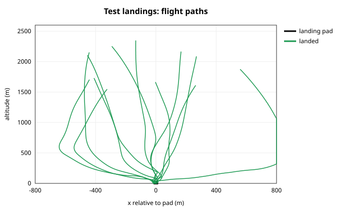
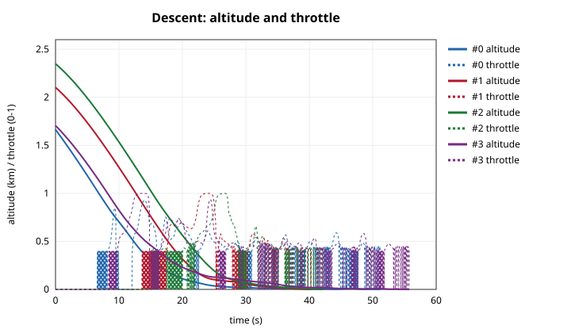
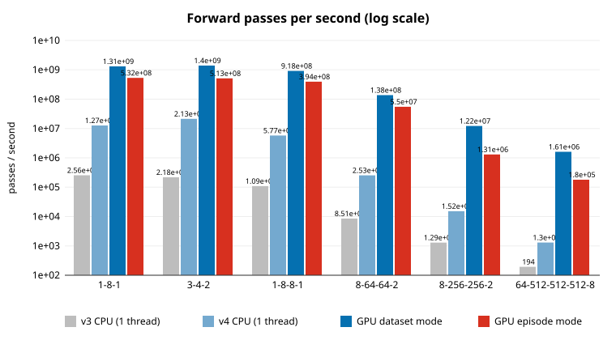
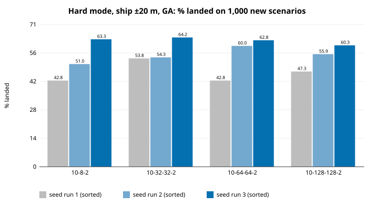
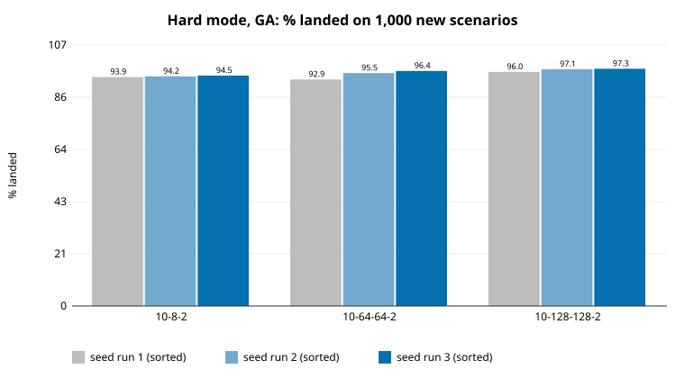
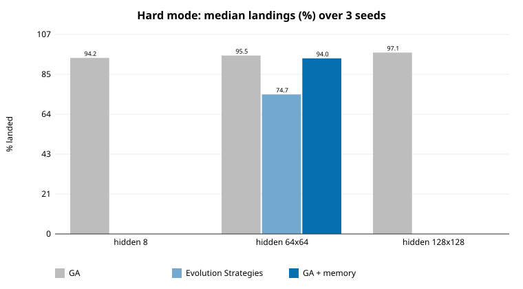
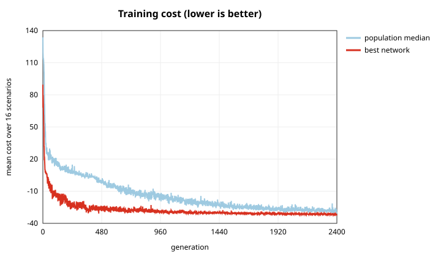

# GPU Neural Network + Booster Landing: report

**Bottom line**

1. **The GPU rewrite works and is fast.**
   - Networks built with the original v3 code give the same outputs on the GPU, apart from float rounding.
   - On an RTX 3070, the rocket-size network runs about **16,000× faster** than v3 on one CPU thread.
   - One training run that would take **about 8.5 days** with v3 takes **2–4 minutes**.
2. **The networks learned to land a rocket booster.**
   - *Easy mode (fixed pad):* every network size lands **99.1–100%** of 1,000 flights it never saw. The behavior looks like a real booster's: free-fall with the engine off, a hard braking burn, then a gentle touchdown.
   - *Hard mode* adds a drone ship that sways, an engine that can't throttle below 40% (so the booster can't hover) and stronger wind. There, the networks reach **94–97%**.
3. **In hard mode, bigger networks are better.** All three 128-128 runs (96.0–97.3%) beat all three 8-neuron runs (93.9–94.5%), and the failure rate halves.
4. **The flagship model**, 128-128 trained for 2,400 generations, lands **96.3%** of 1,000 unseen hard-mode flights with **~10% less propellant** than the shorter runs. Its landing rate is no higher: longer training optimized fuel, because that's what the score rewards. It also found a loophole: it **pulses the engine** dozens of times to fake the hover it isn't allowed to do.
5. **Not every "modern improvement" helped.** I tried Evolution Strategies (OpenAI-ES with Adam), short-term memory, and a small output-layer initialization. They lost to a well-tuned genetic algorithm here. The two things that did matter were **annealing the mutation size** and **making the problem realistic**.

The problem itself is described in [PROBLEM.md](PROBLEM.md). **Day 2 follow-up:** [REPORT_DAY2.md](REPORT_DAY2.md) works through the next steps below. It adds a faster kernel and a much more realistic "real mode" (3 engine starts, sensor noise and delay, deck heave), and trains a real-mode model that lands 85.5% of flights.

<p align="center">
  
  
</p>

*The flagship network's first 12 test flights (hard mode), drawn relative to the moving pad (left), and altitude and throttle against time (right).*

---

## 1. The GPU rewrite (v4)

**What changed from v3:**
- **Flat weights.** Each network is one array of floats instead of a tree of `Node`/`Layer` objects with a `std::vector` per node. A whole population sits in one GPU buffer.
- **Two ways to run a population:**
  - *Dataset mode* is a batched, tiled matrix multiply over (samples × neurons × networks), so large networks fill the GPU.
  - *Simulation mode* gives each episode one thread block, which runs the network and the physics step by step inside the GPU. A training generation is 32,768 complete flights in one kernel launch.
- **Evolution on the GPU.** Initialization, mutation and copying all run on the GPU. Each generation, only one score per network goes to the CPU and one parent index per child comes back.
- **The same math as v3.** Inputs pass straight through, every layer uses tanh, and the bias nodes become bias vectors. v3's unused weights (into the next layer's bias node) are dropped.

### Verification against v3
`verify_bench.exe` builds networks with **v3's own `neural_network.h`**, converts their weights, and compares outputs on 1,000 random inputs:

| Network | Weights | max \|GPU − v3\| |
|---|---|---|
| 1-8-1 | 25 | 1.8e-7 |
| 3-4-2 | 26 | 1.9e-7 |
| 1-8-8-1 | 97 | 2.5e-7 |
| 8-64-64-2 | 4,866 | 2.4e-6 |
| 8-256-256-2 | 68,610 | 6.4e-6 |
| 64-512-512-512-8 | 562,696 | 7.2e-5 |

These are float-vs-double rounding differences only.

### Speed (forward passes per second, RTX 3070)



| Network | v3 CPU (1 thread) | v4 CPU (1 thread) | GPU dataset mode | GPU simulation mode |
|---|---|---|---|---|
| 3-4-2 (cart-balance size) | 218,000 | 21 million | 1.4 billion | 513 million |
| 8-64-64-2 (rocket size) | 8,500 | 253,000 | **138 million** | 55 million |
| 8-256-256-2 | 1,300 | 15,000 | 12 million | 1.3 million |
| 64-512-512-512-8 (563k weights) | 194 | 1,300 | 1.6 million | 180,000 |

- **v4 on one CPU thread is already 7–98× faster than v3** (most for small networks). Most of that comes from dropping v3's per-call vector allocations.
- **The GPU, in dataset mode, adds another 65–1,200× on top of v4 on the CPU.**
- **A training run,** 6.6 million flights averaging 954 steps, is about 6.3 billion forward passes: roughly **8.5 days** at v3's speed, versus **2.4–4.3 minutes** measured. That's a rough estimate that ignores the physics cost.
- **Simulation mode is slower than dataset mode,** because each block waits for one thread to do the physics. While training, `nvidia-smi` shows the GPU **100% busy at full clock but drawing only ~50% of its power limit**. There's headroom, as covered in the next steps.

---

## 2. Easy mode: solved, even by tiny networks

Fixed pad, throttle 0–100%. GA, population 1,024, 16 scenarios per generation, 400 generations, seeds 1–3, each tested on the same 1,000 unseen scenarios:

| Network | Weights | Landed (seeds 1, 2, 3) | Training time |
|---|---|---|---|
| 8-8-2 | 90 | 99.5%, 99.8%, **100%** | ~20 s |
| 8-32-32-2 | 1,410 | 99.9%, 99.9%, 99.1% | ~40 s |
| 8-64-64-2 | 4,866 | 99.8%, 99.7%, 99.8% | ~145 s |
| 8-128-128-2 | 17,922 | 99.9%, 99.1%, 99.9% | ~340 s |

The networks discovered a real landing technique on their own:
1. free-fall with the engine **off** for ~10 s
2. a **full-throttle braking burn** at ~470 m, tilted up to 30° to cancel sideways drift
3. a slow final descent at ~40% throttle

They touch down a mean of 2.4 m from the pad's center. See `outputs/easy_64x64/descent.svg`.

**Lesson:** easy mode is too easy to reward a bigger network, which is why hard mode exists.

---

## 3. Hard mode: what it took

Hard mode adds a swaying drone ship, a 40% minimum throttle with a 0.3 s lag (so the booster can't hover and must time a single "hoverslam" burn) and stronger, gustier wind.

### 3.1 First attempt: bigger was *worse*
At 400 generations: 8-node network **32.3%**, 64-64 network **21.5%**. Two problems:
- **Fixed mutation size.** σ = 0.03 applied to all 5,000 weights is a huge random jump for a big network. Giving it 800 generations and 32 scenarios per generation, the 8-node network reached 35.9%, and the 64-64 network with smaller fixed steps (σ = 0.01) only 31.8%.
- **Annealing fixed it.** With the same budget, shrinking the mutation from σ = 0.03 to 0.005 over training took the 64-64 network to **62.8%**. Big networks need large steps early (to find the strategy) and small steps late (to refine it).

### 3.2 Second attempt: the ship was unrealistic
With annealing, all sizes plateaued at **43–64%**, and seed-to-seed spread was larger than the differences between sizes:



In the best model, **75% of crashes were gentle, on-pad touchdowns still sliding sideways** faster than 1.5 m/s relative to the deck. I had made the ship sway ±20 m on an 8–14 s period, a deck moving at up to **15.7 m/s** and accelerating at up to **12 m/s²**. Real drone ships move a few m/s at most. Landing on that deck was partly luck. I changed the default to ±5 m (up to 3.9 m/s). `ship=20` still reproduces these runs exactly.

### 3.3 Realistic hard mode: bigger is better

GA, population 1,024, 32 scenarios per generation, 800 generations, σ annealed 0.03 → 0.005:

| Setup | Weights | Landed (seeds 1, 2, 3) | Median | Time per run |
|---|---|---|---|---|
| GA, 10-8-2 | 106 | 94.5%, 93.9%, 94.2% | 94.2% | 1.7 min |
| GA, 10-64-64-2 | 4,994 | 95.5%, 96.4%, 92.9% | 95.5% | 10.5 min |
| **GA, 10-128-128-2** | 18,178 | **97.1%, 96.0%, 97.3%** | **97.1%** | 19 min |
| ES, 10-64-64-2 | 4,994 | 75.6%, 74.7%, 71.7% | 74.7% | 10 min |
| GA + memory, 22-64-64-2 | 5,762 | 94.0%, 96.4%, 92.1% | 94.0% | 12.5 min |



- **Bigger networks win consistently.** Every 128-128 seed beats every 8-node seed, and failures drop from ~5.8% to ~2.9%.
- **The bigger networks also land more precisely:** a mean of 3.5–4.5 m from the pad's center, versus 4.7–4.8 m. They miss the pad 1–10 times per 1,000 flights instead of 9–16.
- **What's left:** most remaining failures are touchdowns still drifting sideways at over 1.5 m/s relative to the deck.

### 3.4 Modern improvements that did NOT pay off here



| Tried | What happened |
|---|---|
| **Evolution Strategies** (mirrored sampling, centered ranks, Adam, weight decay), the method OpenAI used to scale neuroevolution | **74.7% vs GA's 95.5%** at the same compute. Its first versions failed completely; the next row explains why. ES estimates a gradient from noisy, mostly all-or-nothing results, and on this task GA's direct selection copes better with that noise. |
| ES failure: stuck in a flat region | Hard mode's "engine off" zone (throttle output < −0.2) means many networks fly *identical* free-fall crashes. ES's first Adam step pushed every network into that zone and training stopped. I also found a bug: tied scores got different ranks, which turned the "gradient" into a random walk. **Fixes:** tie-aware ranks, plus a near-zero output-layer initialization so every network starts mid-throttle (standard practice in reinforcement learning). |
| **Short-term memory** (previous observation + previous command as extra inputs, so the network can infer accelerations such as wind) | No gain: 94.0% vs 95.5%, within seed noise. The wind is steady enough that reacting to the current state works. |

**Lesson:** the "modern" method isn't automatically better. Annealed GA plus a realistic problem plus a bigger network did more than any of these.

---

## 4. The flagship model

**Setup:** realistic hard mode; GA; a 10-128-128-2 network (18,178 weights); population 1,024; 32 scenarios per generation; **2,400 generations** (3× the comparison runs); σ annealed 0.03 → 0.005; seed 1.

Training took **56 minutes** (1.4 s per generation, 78.7 million simulated flights).

| | Flagship (2,400 gens) | Same network, 800 gens (seeds 1, 2, 3) |
|---|---|---|
| **Landed (1,000 unseen flights)** | **96.3%** | 97.1%, 96.0%, 97.3% |
| Mean cost (what training minimizes) | **−29.86** (best) | −29.37, −29.69, −29.84 |
| Propellant per landing | **3,461 kg** | 3,907, 3,842, 3,805 kg |
| Failures | 23 sideways drift, 4 tilt, 2 off pad, 2 tipped, 6 mixed | (similar mix) |
| GPU vs CPU check | 200/200 | 200/200 each |



**What 3× more training bought:**
- **Better on what the score rewards.** The cost improved steadily to the end of training, and the network uses **~10% less propellant** than the same network at 800 generations.
- **Not more landings.** The landing rate stayed within the range of the shorter runs. The score gives a bonus for leftover propellant, so evolution learned to cut margins rather than add safety.
- **The lesson:** *the objective decides what improves.* To push the landing rate higher, the landing bonus should outweigh fuel savings, or failures should cost more.

**How it lands** (successful landings):
- touchdown a mean of **3.9 m** from the pad's center
- **1.4 m/s** down and **0.55 m/s** sideways relative to the deck
- flights last **48 s** on average

**The loophole it found:** the minimum throttle (40%) is more thrust than the nearly empty booster weighs, so it can't hover. Instead, it **switches the engine off and relights it 35–115 times per flight** in the final descent, averaging its thrust down to about hover level. Real engines can't do this (a Merlin relights a handful of times per flight). It's a direct consequence of the "unlimited relights" simplification listed in [PROBLEM.md](PROBLEM.md). Limiting relights is the obvious next step, and would force a true single-burn hoverslam.

Its weights are in `outputs/flagship/weights.txt`, with every test flight in `test.csv` and the first 12 flights, step by step, in `trajectories.csv`.

---

## 5. What kinds of problems this suits

This setup (many small-to-medium networks evolved in parallel inside a GPU simulation) is strongest when:

| Good fit | Why |
|---|---|
| **Control with physics you can simulate:** landing, balancing, docking, drones, robot arms, attitude control | The whole simulation runs inside the GPU kernel, so millions of episodes are cheap |
| **Only an end score:** "did it land?", with no right answer at each step | Evolution needs only a score per episode; there's no gradient through the physics |
| **Non-differentiable or discontinuous rules:** engine on/off, minimum throttle, contact, all-or-nothing success | These break gradient methods; evolution doesn't care |
| **Robust behavior over many random conditions** | Each generation can test every network against dozens of random scenarios |
| **Small-to-medium controllers** (up to ~100k weights) | These fit the GPU's fast on-chip memory; larger ones work but slow down (see the benchmark) |

| Poor fit | Use instead |
|---|---|
| Supervised data with known answers (images, text, regression like the sine task) | Backpropagation: the sine report showed gradient descent reaches about 100× lower error |
| Very large networks (millions of weights) | Gradient-based reinforcement learning (PPO, SAC), or backprop |
| Slow or external simulators (games, CAD, hardware) | Fewer, smarter evaluations |

**Natural next problems for this code:**
- **Space State** (your orbital mechanics project): finite-burn guidance, such as lunar orbit insertion, with the N-body physics moved into the kernel
- 3D booster landing with grid fins
- a double inverted pendulum (swing-up and balance)
- multiple drones avoiding each other
- satellite attitude control with reaction wheels

---

## 6. Lessons learned (in order of impact)

1. **Make the problem realistic before tuning the model.** The ±20 m ship capped every network at ~55% and made size look irrelevant. Fixing it was the largest single improvement of the night.
2. **Anneal the mutation size for big networks.** It doubled the 64-64 network's landing rate (31.8% → 62.8%) and is what let bigger networks win.
3. **Check *how* the model fails, not just how often.** Breaking crashes down by cause found the ship problem in one query.
4. **Watch for flat regions.** An action "dead zone" with tied scores silently stopped ES. Tie-aware ranks and a small output initialization are cheap insurance.
5. **The "modern" method isn't automatically better.** ES and memory both lost to a tuned GA here.
6. **Seeds matter.** Single-seed pilots pointed the wrong way more than once; all comparisons above use 3 seeds.
7. **Determinism pays off.** Every run reproduces exactly from its seed, which caught regressions immediately: easy-mode and `ship=20` results reproduced bit for bit after every code change.

## 7. Next steps

- **Use more of the GPU** (it's 100% busy but only at ~50% of its power):
  - run several scenarios per thread block, so the physics isn't one thread while the others wait
  - pack several small networks into one block
  - use half-precision tensor cores in dataset mode
- **Hybrid training:** evolve until the landing rate plateaus, then fine-tune with gradients through a differentiable version of the physics.
- **Make the problem harder:** deck heave and pitch, sensor noise and delay, limited engine relights, landing legs that can fail, and 3D.
- **Fix the two flaws the flagship exposed:**
  - **limit engine relights** (for example, to 3), so it has to perform a real hoverslam
  - **reweight the score** so that landing safely is worth more than saving propellant
  
  The flagship's cost was still improving at 2,400 generations, so after those fixes, longer runs should pay off.

## Reproducing

All runs are deterministic per seed. The build directory needs `rocket.exe` (`build.bat`); then from Git Bash:

```bash
NAME=easy         EXTRA="mode=easy"                                                   ./sizes.sh 400 "8 32,32 64,64 128,128"
NAME=ga_hard20    EXTRA="mode=hard ship=20 algo=ga scen=32 sigma=0.03 sigma_end=0.005" ./sizes.sh 800 "8 32,32 64,64 128,128"
NAME=ga_hard5     EXTRA="mode=hard ship=5 algo=ga scen=32 sigma=0.03 sigma_end=0.005"  ./sizes.sh 800 "8 64,64 128,128"
NAME=es_hard5     EXTRA="mode=hard ship=5 algo=es scen=32 lr=0.01 sigma=0.05 out_init=0.01" ./sizes.sh 800 "64,64"
NAME=ga_hard5_mem EXTRA="mode=hard ship=5 algo=ga scen=32 sigma=0.03 sigma_end=0.005 hist=1" ./sizes.sh 800 "64,64"
./rocket.exe mode=hard ship=5 algo=ga hidden=128,128 scen=32 sigma=0.03 sigma_end=0.005 seed=1 gens=2400 out=outputs/flagship
python plot_rocket.py && python plot_rocket.py outputs/flagship
```

The first `ship=20` sweep (shown as `sizes_ga_hard20`) originally ran under the name `ga_hard`, before the `ship` setting existed. Its results are identical, which I checked by rerunning one of its runs.

**Run times:**
- ~28 min for easy mode
- ~1.75 h for `ship=20`
- ~2.75 h for the realistic hard-mode set
- ~1 h for the flagship
