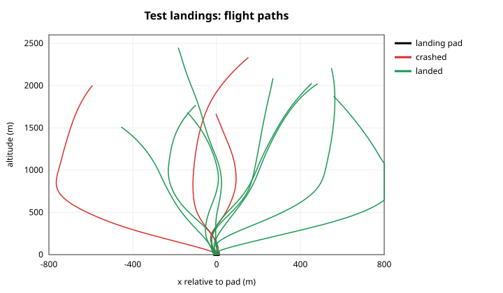
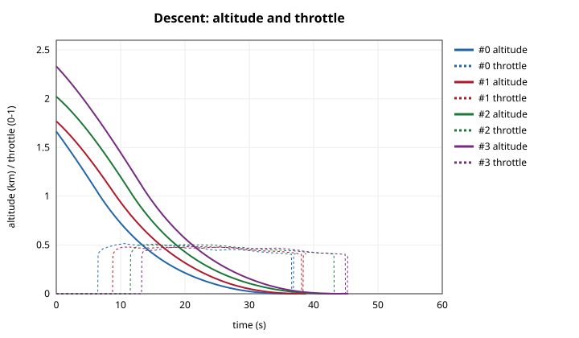
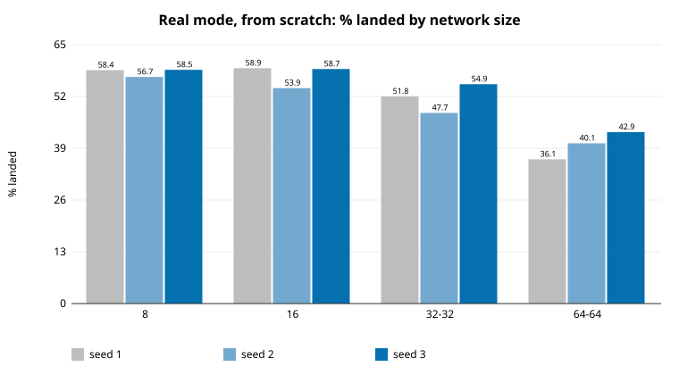
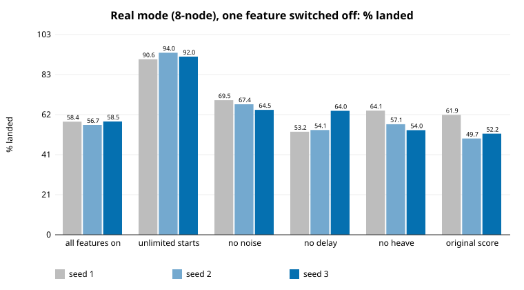
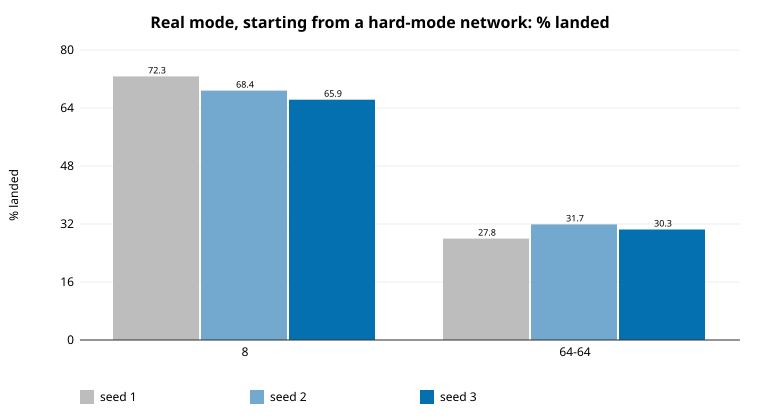
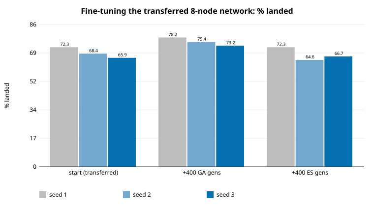
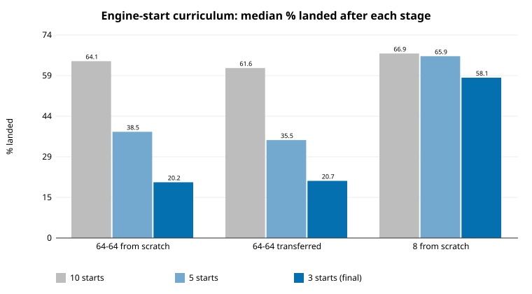
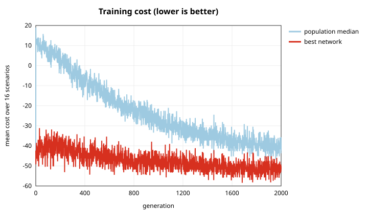
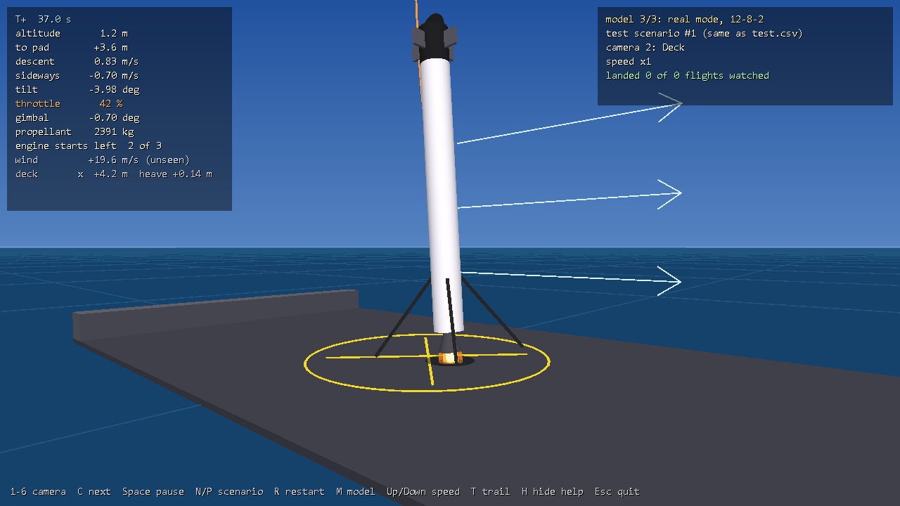
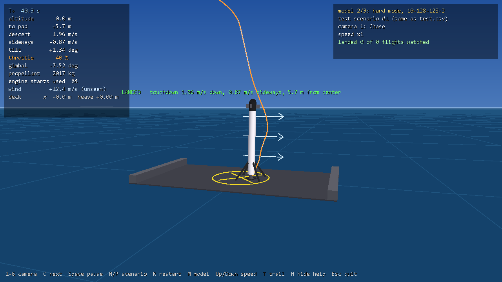

# Day 2 report: real mode, a faster kernel, transfer learning

Today I worked through the "next steps" from [REPORT.md](REPORT.md) (night 1).

**Bottom line**

1. **A faster GPU kernel.** One *warp* per flight, with 8 flights of the same network sharing a block, is **1.3–1.9× faster** for networks up to 64 wide. It's selected automatically (`kernel=auto`), and the original kernel is still available (`kernel=block`) to reproduce night 1 exactly.
2. **A much more realistic problem: `mode=real`.** It adds a **3-start limit on the engine**, a **safety-first score**, **sensor noise**, **0.1 s sensor delay** and a **heaving deck**. It closes the loophole the night-1 flagship found (pulsing the engine 35–115 times per flight). It's much harder: the same training that landed 94–97% in hard mode now lands 40–59%.
3. **What makes it hard:** almost entirely the **engine-start limit**. With unlimited starts, the same network lands **92%**, but it uses 61 starts per flight. Sensor noise costs about 9 points; delay and heave barely matter.
4. **The best recipe:** train a **small network in hard mode, transfer it into real mode, then fine-tune with the GA**. That raised the real-mode landing rate from **58% to 75%**, consistently across 3 seeds. The **real-mode flagship** trained this way lands **85.5%** of 1,000 unseen real-mode flights, using **2 engine starts** on average.
5. **In real mode, small networks win.** 8–16 neurons beat 64-64 (58% vs 40%), and transfer *hurts* big networks because it carries over their engine-pulsing habit.
6. **A live 3D visualizer** ([VISUALIZER.md](VISUALIZER.md)) flies the trained networks on the same test scenarios, with six cameras. It reproduces training's test outcomes on 200/200 flights.
7. **ES as a fine-tuner didn't help, and neither did an engine-start curriculum** (10 → 5 → 3 starts); the GA did. The curriculum made big networks worse (64-64: 20% vs 40% without it). Details below.

The problem is documented in [PROBLEM.md](PROBLEM.md), section 8 (real mode).

<p align="center">
  
  
</p>

*The real-mode flagship's first 12 test flights: paths relative to the moving pad (left), and altitude and throttle over time (right). 9 of the 12 landed; scenarios 0, 3 and 5 crashed.*

---

## 1. GPU speed-up: the warp kernel

**Night 1's GPU utilization:** 100% busy, but only about 50% of the power limit. In the original kernel, each flight gets a whole thread block, and every 0.05 s step has to synchronize the entire block, including all the threads that sit idle while one thread does the physics.

**The new kernel** (`episode_kernel_warp` in `rocket.cu`, `forward_warp` in `gpu_nn.cuh`):
- **One warp (32 threads) flies one episode.** Lane 0 does the physics, and all 32 lanes compute the network's neurons.
- **8 flights of the same network share a block,** and that network's weights are loaded into shared memory once for all 8.
- **Only warp-level synchronization inside the flight loop,** so a flight never waits for another.

**Time for one generation** (1,024 networks × 32 flights), mean of 3, idle RTX 3070 (`outputs/kernel_bench.txt`):

| Network | Hard mode: block → warp | Speed-up | Real mode: block → warp | Speed-up |
|---|---|---|---|---|
| 8 | 0.033 → 0.026 s | 1.29× | 0.086 → 0.073 s | 1.18× |
| 16 | 0.032 → 0.026 s | 1.25× | 0.085 → 0.072 s | 1.18× |
| **64-64** | 0.192 → 0.097 s | **1.98×** | 0.362 → 0.148 s | **2.45×** |
| 128-128 | 0.319 → 0.560 s | 0.57× | 0.400 → 0.619 s | 0.65× |

In practice, a 64-64 real-mode run of 800 generations took **5.1 minutes** instead of about 10.

- **When to use it:** for 128-wide layers, each lane would have to compute 4 neurons in sequence, so the original kernel is faster there. `kernel=auto` picks the warp kernel when every layer is 64 wide or less, and the block kernel otherwise.
- **The two kernels are not bit-identical.** They agree on the mean cost of 32,768 flights to 4 decimal places, and no single flight differs by as much as 1 cost point, but about 1.5% of flight costs differ in the last digits. The compiler fuses floating-point operations differently in the two kernels.
- **Reproducing night 1:** I re-checked the easy and `ship=20` results with `kernel=block` after every change today, and both still reproduce exactly (995 and 633 landings).

**Deferred, with reasons:**
- **Tensor cores** would only speed up dataset mode (the batched matrix multiply). Training uses episode mode, whose per-step matrix-vector products are too small for tensor cores.
- **Packing several *different* networks into one warp** would help tiny networks (8 neurons use only 8 of 32 lanes), but it makes the kernel much more complex. It's the next speed-up worth doing.

## 2. Real mode (`mode=real`)

See [PROBLEM.md §8](PROBLEM.md) for the full definition. In short:

| Change | Setting | Why |
|---|---|---|
| Engine can be started at most 3 times | `ignitions=3` | Closes the engine-pulsing loophole; forces a real hoverslam |
| Landing bonus 60 (was 30), fuel bonus ≤5 (was 10), crash +20 | `score=1` | Night 1's flagship traded safety for fuel |
| GNSS/IMU-level sensor noise | `noise=1` | Real sensors are noisy |
| 0.1 s sensor delay | `delay=2` | Real sensors are late |
| Deck heaves up to ±1.5 m | `heave=1.5` | Real seas |

The network gets two more inputs (engine starts left and the deck's vertical speed), for 12 in total. Every new feature is off outside `mode=real`, and the easy and hard results still reproduce exactly.

## 3. Results

All runs: GA, population 1,024, 32 scenarios per generation, σ annealed 0.03 → 0.005 (σ 0.01 → 0.002 for fine-tuning), seeds 1–3, each tested on the same 1,000 unseen scenarios. Every one of the 51 runs matched the CPU reference on 200 of 200 checked flights.

### 3.1 Network size (from scratch, 800 generations)



| Network | Weights | Landed (seeds 1, 2, 3) | Median | Training time |
|---|---|---|---|---|
| 12-8-2 | 122 | 58.4%, 56.7%, 58.5% | **58.4%** | 2.8 min |
| 12-16-2 | 242 | 58.9%, 53.9%, 58.7% | **58.7%** | 2.9 min |
| 12-32-32-2 | 1,538 | 51.8%, 47.7%, 54.9% | 51.8% | 3.4 min |
| 12-64-64-2 | 5,122 | 36.1%, 40.1%, 42.9% | 40.1% | 5.1 min |
| 12-128-128-2 (seed 1 pilot) | 18,434 | 18.6% | | 13.8 min |

**In real mode, the size trend reverses.** In hard mode, 128-128 beat 8 on every seed. Here, bigger networks learn much more slowly. A single-seed check also showed that **no tuning fixes this at 800 generations**: sparse mutation, a near-zero output init, 64 scenarios per generation and stronger selection all scored 33–39% for 64-64 (`outputs/day2_pilots.txt`).

**Big networks do catch up, slowly.** Trained 6× longer (4,800 generations, 31 minutes), the 64-64 network reached **61.7%**, up from 36.1% at 800 and 38.3% at 2,400, and it was still improving at the end. That's about the same as the 8-node network reaches in 2.8 minutes, so within any realistic budget the small network is the better choice for real mode.

### 3.2 What makes real mode hard (ablation, 8-node)



| Switched off | Landed (median of 3) | Change | Engine starts per flight |
|---|---|---|---|
| nothing (all real-mode features) | 58.4% | | 2.4 |
| **engine-start limit** (`ignitions=0`) | **92.0%** | **+33.6** | **60.6** |
| sensor noise (`noise=0`) | 67.4% | +9.0 | 2.5 |
| deck heave (`heave=0`) | 57.1% | −1.3 | 2.5 |
| sensor delay (`delay=0`) | 54.1% | −4.3 | 2.4 |
| safety-first score (`score=0`) | 52.2% | **−6.2** | 2.5 |

- **The engine-start limit is almost the whole difficulty.** Without it, the network immediately rediscovers night 1's trick, pulsing the engine about 60 times per flight. A real booster can't do that, so the limit is the right call.
- **Sensor noise matters** (9 points).
- **Delay and heave are within seed noise.** At 0.1 s and ±1.5 m they're mild. A realistic next step is to make them harsher.
- **The safety-first score helps:** switching back to the original score costs 6 points.

### 3.3 Transfer learning and fine-tuning



**Transfer:** starting from the realistic hard-mode network of the same seed (night 1), with zero weights on the 2 new inputs:

| | From scratch (median) | Transferred (seeds 1, 2, 3) | Median |
|---|---|---|---|
| 12-8-2 | 58.4% | **72.3%, 68.4%, 65.9%** | **68.4%** (every seed better than every from-scratch seed) |
| 12-64-64-2 | 40.1% | 27.8%, 31.7%, 30.3% | 30.3% (worse) |
| 12-128-128-2, from the night-1 flagship (seed 1, 2 σ settings) | 18.6% | 0.0%, 0.2% | stuck |

**Transfer brings habits along, good and bad.** The small hard-mode networks had learned a sound braking strategy that carries over. The big ones had learned to pulse the engine dozens of times. Under a 3-start limit, that strategy fails instantly, and 800 generations weren't enough to unlearn it. The 128-128 flagship's transfer got stuck in exactly that way.



**Fine-tuning the transferred 8-node networks:** 400 more generations, with the same number of flights for each method:

| | Start | + GA (small steps) | + ES (σ 0.01, lr 0.003) |
|---|---|---|---|
| Seed 1 | 72.3% | **78.2%** | 72.3% |
| Seed 2 | 68.4% | **75.4%** | 64.6% |
| Seed 3 | 65.9% | **73.2%** | 66.7% |

**GA fine-tuning gains 6–7 points on every seed; ES gives no consistent gain.** That's the third test in which ES lost to the GA on this problem, this time in the local-refinement role it's usually best at. The likely reason is the same each time: fitness here is a few dozen all-or-nothing landings per generation, which makes ES's gradient estimate very noisy, while GA selection with elitism only needs to rank candidates.

### 3.4 An engine-start curriculum (doesn't help)

**The idea:** big networks fail because they learn to rely on many engine starts. So loosen the limit and tighten it gradually: 400 generations each at 10, then 5, then 3 starts (`curriculum.sh`, 3 seeds).



| Variant | 10 starts | 5 starts | **3 starts (final)** | For comparison: 3 starts from the beginning, 800 gens |
|---|---|---|---|---|
| 64-64 from scratch | 64.1% | 38.5% | **20.2%** (24.7, 19.4, 20.2) | 40.1% |
| 64-64 transferred from hard mode | 61.6% | 35.5% | **20.7%** (20.7, 15.0, 25.1) | 30.3% |
| 8 from scratch | 66.9% | 65.9% | **58.1%** (58.1, 71.9, 48.2) | 58.4% |

(Medians of 3 seeds; per-seed values in brackets.)

- **Clear negative result.** With 10 starts, the big networks do well (64%), so starts aren't their problem when they're plentiful.
- **Every tightening knocks them down,** and 400 generations per stage isn't enough to recover. After 1,200 generations in total they end *worse* than networks trained at 3 starts for 800 generations from the start.
- **The 8-node network ends level with training from scratch,** just with more variation between seeds.

**Why:** with 10 starts allowed, both sizes build strategies around relighting: 64-64 networks used 6.8–9.0 starts, and 8-node networks 6.4–7.5. The difference is how fast they re-adapt. When the limit drops, the 8-node networks find a new strategy within 400 generations, and the 64-64 networks don't. That matches what we saw everywhere else in real mode: big networks learn this problem slowly. A gentler schedule (more stages, more generations each) might still work, but it would cost more than just training small. I didn't run 1,200-generation from-scratch controls, because the curriculum already loses to 800-generation training.

## 4. The real-mode flagship

**Training path** (each stage starts from the previous one's network):

| Stage | Mode | Generations | Landed (its own mode) |
|---|---|---|---|
| 1. Train 10-8-2 from scratch (night 1) | hard | 800 | 94.5% |
| 2. Transfer to 12-8-2, retrain | real | 800 | 72.3% |
| 3. Fine-tune with small steps | real | 400 | 78.2% |
| **4. Fine-tune with 64 scenarios per generation** (σ 0.01 → 0.002) | real | 2,000 | **85.5%** |

Stage 4 took **14 minutes**. The whole chain is about 20 minutes of GPU time for a 122-weight network.

**Results on 1,000 unseen real-mode flights:**

| | |
|---|---|
| **Landed** | **85.5%** (crashed 14.5%, tipped 0, timeout 0) |
| Engine starts per flight | 1.97 on average: one start in 20% of flights, two in 63%, three in 17% |
| Successful landings | 4.5 m from the pad's center on average; 1.6 m/s down and 0.6 m/s sideways relative to the deck; 3,078 kg of propellant |
| Failures | 89 sideways drift above 1.5 m/s, 28 too fast vertically, 7 off the pad, 21 mixed. Most are near-misses: 87% of crashes touched down at under 4 m/s vertically. |
| GPU vs CPU check | 200/200 |



**How it lands with only 3 engine starts.** It free-falls for 6–12 s, then lights the engine about 1 km up and flies **one long, gentle burn at 45–50% throttle**. While the booster is still heavy with propellant, that's close to hovering thrust. As propellant burns off it eases toward the 40% minimum. Right at the deck, it either touches down on that burn or cuts the engine and relights once for a final cushion; that relight is the second start in most flights.

This is a different strategy from a short, hard hoverslam. It uses the booster's own changing mass to make a minimum-40% engine behave almost like a throttleable one. It costs more propellant than a hoverslam (3,078 kg), but under the safety-first score, safety is worth more.

### 4.1 Two late attempts to beat it (both ties)

| Attempt | Landed | Propellant | Engine starts | Training |
|---|---|---|---|---|
| Flagship + 1,000 more generations at **128 scenarios** per generation (σ 0.005 → 0.001) | 84.0% | 3,112 kg | 2.18 | 14 min |
| **16-node** network through the same chain: hard 94.9% → transfer 73.1% → fine-tune 76.0% → long fine-tune | **84.5%** | **2,871 kg** | 2.39 | 20 min in total |

- **The 8-node network has plateaued at about 85%.** Less noisy selection didn't move it: 84.0% vs 85.5% is within the ±1.1% noise of a 1,000-flight test.
- **The 16-node network ties it** at every stage of the chain, using about 7% less propellant.
- **So the limit now is the problem, not the network size or the selection noise.** The remaining failures are mostly sideways drift above 1.5 m/s at touchdown. With 3 engine starts and noisy, delayed sensors, there may simply not be enough control authority in the last few seconds to fix it. That would be the next thing to investigate.

The 8-node network (85.5%) stays the real-mode flagship. Both models are in `outputs/` (`flagship_real`, `h16_real_long`).

### 4.2 A bonus for landing quickly (doesn't speed it up)

Added on request: `time_bonus=w` gives a successful landing an extra **w × (1 − flight time / 80 s)** (see [PROBLEM.md](PROBLEM.md) §5). It's off by default, and every earlier result still reproduces exactly. I tested it on real mode, 8-node network, 3 seeds per setting (`time_bonus.sh`, `outputs/time_bonus_summary.csv`):

| Setting | Bonus | Landing time (seeds 1, 2, 3) | Landed |
|---|---|---|---|
| Fine-tune flagship, small steps | 0 (control) | 40.6, 40.6, 41.7 s | 82–85% |
| | 10 | 41.2, 39.9, 40.1 s | 81–83% |
| | 30 | 40.4, 40.5, 39.0 s | 81–83% |
| Fine-tune flagship, larger steps | 0 (control) | 40.9, 40.9, 39.0 s | 77–81% |
| | **150** | 40.7, 40.6, 40.9 s | 77–80% |
| From scratch | 0 (control: §3.1's runs) | 39.4, 40.6, 40.2 s | 57–59% |
| | **150** | 39.6, 38.2, 40.1 s | 50–63% |

**Even a large bonus makes landings no more than about a second faster,** whether the network starts from the flagship or from scratch. The real-mode flagship itself lands in 34–51 s (median 41.5 s).

**There's time to gain,** so it isn't physics. An idealized fastest landing (free-fall, then a perfectly timed full-throttle braking burn) takes only **16–27 s** from these starting conditions.

**Why evolution doesn't take it:**
- **A fast landing is a short, full-throttle hoverslam,** started late. That's a very different strategy from the long, gentle burn every real-mode network converges on.
- **It's risky in real mode.** The engine can't throttle below 40%, needs 0.3 s to respond, and has 3 starts, while the sensors are noisy and late. A hard burn timed slightly wrong means a crash, which costs far more than a few seconds earn: with bonus 150, landing 5 s faster gains about 9 points, against a 60-point landing bonus plus a 20-point crash penalty.
- **The long burn uses the booster's own weight.** Close to hover thrust while heavy, it slowly lightens and descends. That's what makes landing with a minimum-40% engine reliable, and it inherently takes time.

**Takeaways:**
- **To get faster landings,** the rules have to make the fast strategy safe enough, for example deeper throttling (`min_throttle`), more engine starts, or a smaller time penalty for a slightly harder touchdown. A bigger bonus alone just gets traded away for safety.
- **Fine-tuning at 32 scenarios per generation slightly *lowers* the flagship's landing rate** (77–85%, even with no bonus, vs 85.5%). The flagship's final stage used 64 scenarios per generation; noisier evaluation lets it drift. So none of these models replaces the flagship.

### 4.3 A landing gate: line up 10 m above the deck (no clear effect)

**The idea:** the booster should already be lined up a few meters above the deck, so the last meters are a straight drop. This targets sideways speed at touchdown, which is the most common way G-FOLD fails and a frequent one for the networks. `align=w` adds w × misalignment at 10 m to the cost: distance to the pad / 5 m, plus sideways speed / 1 m/s, plus tilt / 3°, plus spin, capped at 3 (see PROBLEM.md). The script is `align.sh`, the results `outputs/align_summary.csv`. Real mode, 8-node network, % of 1,000 test flights landed:

| Run | Seed 1 | Seed 2 | Seed 3 | Median |
|---|---|---|---|---|
| From scratch, no gate (day 2, section 3.1) | 58.4 | 56.7 | 58.5 | **58.4** |
| From scratch, gate w = 5 | 56.3 | 51.4 | 59.3 | 56.3 |
| From scratch, gate w = 10 | 52.6 | 50.2 | 59.4 | 52.6 |
| Flagship fine-tune, 400 gens, no gate | 80.3 | 83.9 | 81.5 | 81.5 |
| Flagship fine-tune, 400 gens, gate w = 10 | 82.3 | 80.6 | (stopped) | — |

**Takeaways:**
- **From scratch, the gate slightly hurts,** and more so at w = 10. It adds a second goal that competes with simply landing, while the networks are still learning to land at all.
- **On the flagship it's a wash:** +2.0 points on seed 1, −3.3 on seed 2. The flagship already passes 10 m well lined up: its average gate penalty at w = 10 is 2.4 of a possible 30.
- **The first version was a reward-hacking lesson.** It charged only landings and crashes. Tipping over (cost about 100, no gate term) then became cheaper than a fast crash plus the gate, so training learned to tip over on **991 of 1,000** flights. The gate now applies to every outcome.
- **The seed-3 gate fine-tune was stopped before finishing,** to free the GPU.

## 5. What I deferred, and why

| Next step from night 1 | Status |
|---|---|
| Use more of the GPU | **Done** (warp kernel, 1.3–1.9×). Tensor cores don't apply to episode mode; packing several networks per warp is the next speed-up. |
| Limit engine relights | **Done** (`ignitions=3`). It turned out to be the main source of difficulty. |
| Reweight the score toward safety | **Done** (`score=1`): +6 points |
| Sensor noise and delay | **Done** (`noise=1`, `delay=2`) |
| Deck heave | **Done** (`heave=1.5`). Deck pitch is not done. |
| Hybrid training | **Done as transfer + fine-tuning** (GA works, ES doesn't). Full gradient fine-tuning through *differentiable physics* is not done: it needs a backward pass through the network and the simulator for every step of 1,000-step flights, which is days of work. With only 122 weights, it's also not clearly needed. |
| Landing legs, 3D | **Not done.** 3D roughly doubles the state and actions and needs quaternion attitude; landing legs need contact dynamics. Each is a project of its own. |
| Curriculum for the engine-start limit (proposed this morning) | **Done, negative:** 10 → 5 → 3 starts made 64-64 networks worse (20% vs 40%) and didn't help 8-node ones (§3.4) |
| Train bigger networks longer | **Done:** 64-64 for 4,800 generations reached 61.7% (from 36.1% at 800) and was still improving. Big networks catch up, but slowly. |

## 6. The 3D visualizer

Added this evening, on request: a Windows desktop app that flies the trained networks **live**, in 3D, with six cameras (chase, deck, booster, orbit, 2D side view and cinematic). See **[VISUALIZER.md](VISUALIZER.md)**.

<p align="center">
  
  
</p>

*Left: the real-mode flagship 1.2 m above the drone ship (deck camera). Right: the night-1 hard-mode flagship, landed on the same scenario after **84 engine starts**. The visualizer makes the engine-pulsing loophole obvious.*

- **It runs the same code as training.** It flies with the same physics and network code (on the CPU), on the same test scenarios as the reports.
- **It's verified against training:** re-flying the first 200 test scenarios gives the same outcome as the GPU training run on **200/200** flights, for the easy, hard and real-mode flagships.
- **The problem is still 2D;** the 3D scene is a presentation of that vertical plane.

## 7. Lessons learned today

1. **Make the "real" rules real, then measure which one bites.** One feature, the engine-start limit, accounted for almost all of real mode's difficulty. The ablation took 45 minutes and replaced a lot of guessing.
2. **Bigger isn't automatically better.** It depends on the problem: big networks won hard mode, and small ones win real mode at the same budget.
3. **Transfer carries over habits.** It helped the small networks a lot, and trapped the big ones in an engine-pulsing strategy that no longer works.
4. **Train in stages:** a forgiving problem first, then the strict one, then fine-tune. This was the single biggest gain of the day (58% → 75%).
5. **ES lost again**, this time as a fine-tuner. On noisy, all-or-nothing objectives, simple GA selection with elitism has been the more reliable optimizer here.
6. **Gradual curricula aren't free.** Loosening a constraint lets a network build a strategy around the looser version, and that strategy may not survive the tightening. Here, training at the real constraint from the start was better.
7. **Re-check that old results reproduce after every change.** `kernel=block` reproduced night 1 exactly all day, which is how I know the new features didn't quietly change the old problems.

## 8. Next steps

- **Find out whether ~85% is the problem's ceiling.** Both late attempts tied (§4.1), so the next useful step is a hand-designed controller, or an expensive search on single scenarios, to see whether the failed scenarios are landable at all with 3 engine starts and noisy sensors.
- **Penalize engine starts in the score,** rather than only capping them, so networks never build a strategy around relighting. A gentler alternative to the failed curriculum.
- **Harsher, more realistic delay and heave** (0.2–0.3 s; ±3 m) so they actually test the controller.
- **Pack several networks per warp,** so tiny networks run up to 4× faster.
- **More scenarios per generation for the final stage** (64–128), since the remaining failures are near-misses, and noisy evaluation makes those hard to tell apart.

## Reproducing

```bash
# day-2 experiments (sizes, transfer, ablation, hybrid; resumable, ~2 h)
./day2.sh
# real-mode flagship (needs day2.sh's hybrid run)
./rocket.exe mode=real algo=ga scen=64 sigma=0.01 sigma_end=0.002 hidden=8 seed=1 gens=2000 \
    init=outputs/day2/hybrid/ga_finetune_s1/weights.txt out=outputs/flagship_real
# engine-start curriculum (resumable, ~1 h)
./curriculum.sh
# time bonus (resumable, ~1 h; needs day2.sh's sizes runs as the from-scratch control)
./time_bonus.sh
# 64-64 long run
./rocket.exe mode=real algo=ga scen=32 sigma=0.03 sigma_end=0.005 hidden=64,64 seed=1 gens=4800 out=outputs/long_real_64
# kernel benchmark
./rocket.exe mode=hard hidden=64,64 scen=32 bench_kernels=1
python plot_rocket.py && python plot_rocket.py outputs/flagship_real
# visualizer: build, verify against test.csv, then watch
build.bat visualizer
visualizer.exe --check 200
visualizer.exe
```
