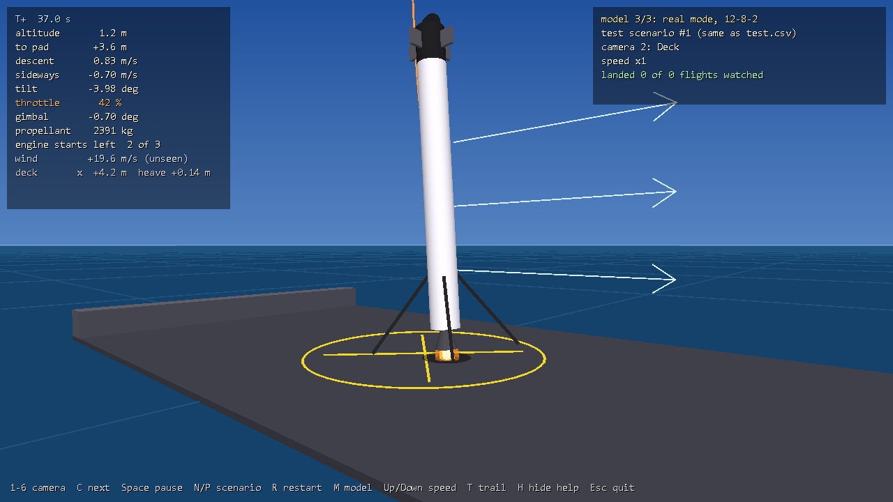
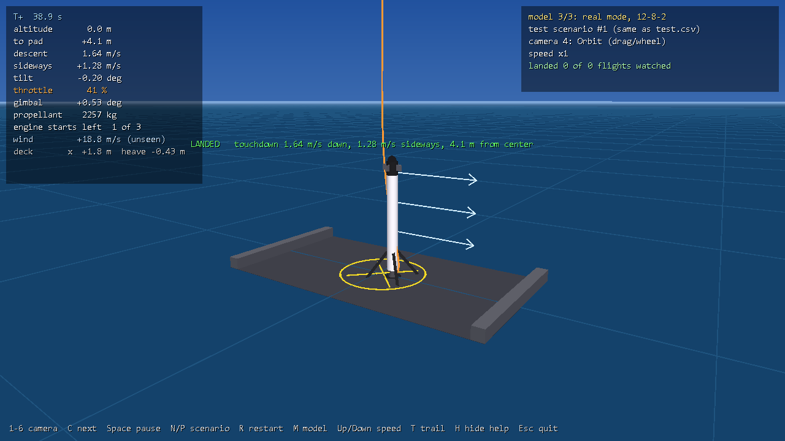
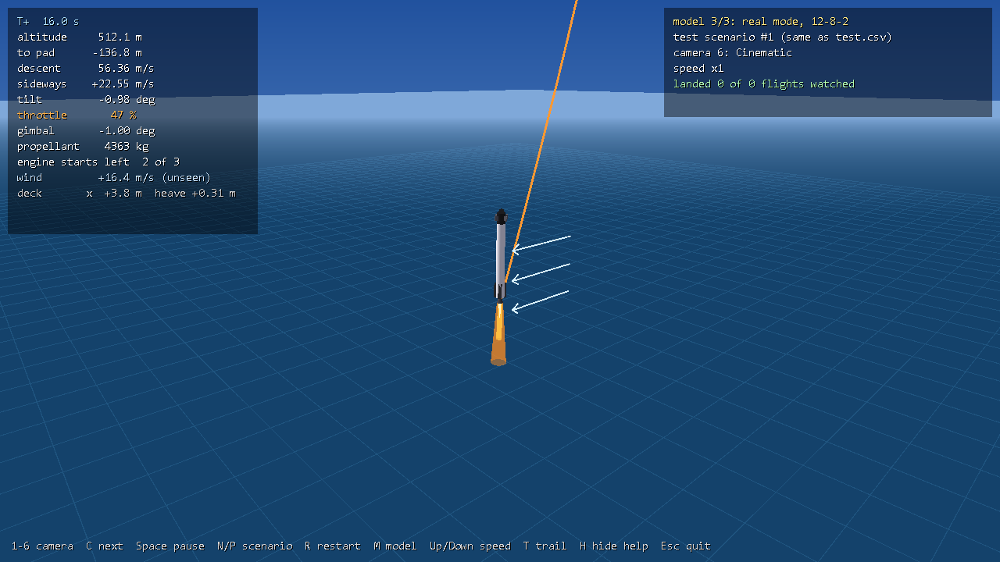
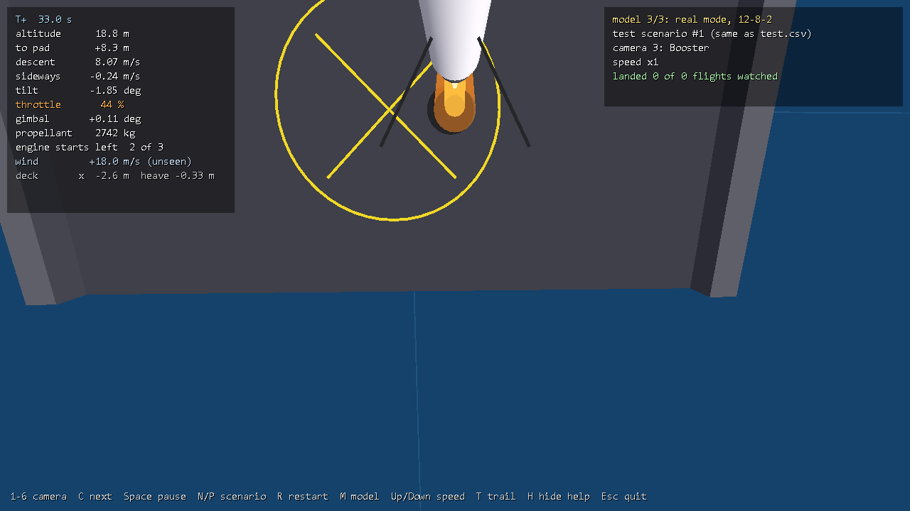
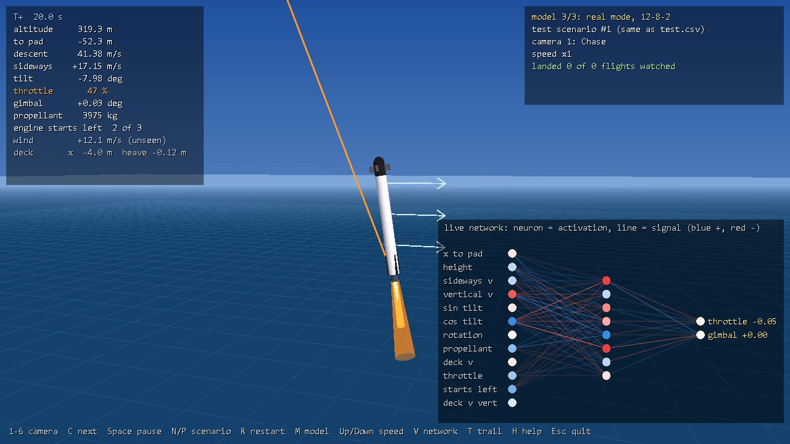

# Booster Landing visualizer

A Windows desktop app that **flies the trained networks live** in a 3D scene: the ocean, a drone ship, the booster and its engine plume, the wind, the flight path, and six cameras.

<p align="center">
  
  
</p>
<p align="center">
  
  
</p>

*Real-mode flagship, test scenario 1. Top: the deck camera 1.2 m before touchdown, and the orbit camera after landing ("LANDED: touchdown 1.64 m/s down, 1.28 m/s sideways, 4.1 m from center"). Bottom: the cinematic camera during the long burn, and the booster camera looking down past the engine at the pad.*

## What you're watching

- **The real networks, live.** Every frame runs the same physics (`rocket.cuh`) and the same network math (`forward_serial` in `gpu_nn.cuh`) as training, on the CPU, with the trained weights. Nothing is pre-recorded.
- **The same test scenarios as the reports.** Test scenario *k* in the app is row *k* of that model's `test.csv`.
- **Checked against training.** `--check` re-flies the first 200 test scenarios and compares every outcome with what training recorded on the GPU. All three flagship models match on **200/200**, including real mode's sensor noise and delay.
- **2D physics, shown in 3D.** The problem is 2D: the booster moves in a vertical plane. The scene adds depth (the ship, legs, cameras), but the motion is exactly the simulated motion.

## Build and run

```bat
build.bat visualizer
visualizer.exe
```

- **With no arguments,** it loads the three flagship models from `outputs/`: easy mode (8-64-64-2), hard mode (10-128-128-2) and real mode (12-8-2). Press **M** to switch between them.
- **To fly other models,** pass their weights files: `visualizer.exe outputs\h16_real_long\weights.txt outputs\flagship_real\weights.txt`. The mode (easy, hard or real) is read from the file.
- **Requirements:** the same CUDA toolkit and Visual Studio C++ tools as the trainer. `nvcc` compiles it, but it runs on the CPU and needs only OpenGL, which every Windows PC has.

## Controls

| Key | Action |
|---|---|
| **1–6** | Camera: 1 chase, 2 deck, 3 booster, 4 orbit, 5 side view (2D), 6 cinematic |
| **C** | Next camera |
| **Space** | Pause / resume |
| **N / P** | Next / previous test scenario. The app also moves on automatically 4 s after each landing or crash. |
| **R** | Restart this flight |
| **M** | Next model |
| **Up / Down** | Speed ×0.25 … ×8 |
| **T** | Toggle the flight-path trail |
| **V** | Toggle the live network view |
| **H** | Hide the help line |
| **Mouse drag / wheel** | Orbit / zoom (switches to camera 4) |
| **Esc** | Quit |

## The cameras

| # | Camera | What it shows |
|---|---|---|
| 1 | **Chase** | Beside and slightly behind the booster, following it all the way down |
| 2 | **Deck** | Standing at the edge of the drone ship, looking up. It zooms in while the booster is high. |
| 3 | **Booster** | Mounted near the top of the booster, looking down past the engine at the deck, like the real onboard cameras |
| 4 | **Orbit** | Free camera around the booster: drag to rotate, wheel to zoom |
| 5 | **Side view (2D)** | Far away with a narrow lens, framing the booster and the ship together. This is the plane the physics actually lives in. |
| 6 | **Cinematic** | A slow automatic orbit that pulls back while the booster is high |

## The HUD

**Left panel (flight data):**
- time since the start
- altitude above the deck, and sideways distance to the pad
- descent and sideways speed relative to the deck
- tilt, throttle (orange while the engine is lit), gimbal angle and propellant
- engine starts: left in real mode, used in other modes (the hard-mode flagship shows its engine-pulsing habit here, with 80+ starts)
- the wind, which the network **cannot** sense
- the deck's sway and heave

**Right panel:** the model, test scenario number, camera, speed, and a running tally of landings.

**After each flight:** the outcome and the touchdown speeds appear in the center of the screen.

## The live network view



The bottom-right panel (**V** toggles it) shows the network thinking, every 0.05 s:
- **Neurons** are colored by their current value: blue positive, red negative, white near zero.
- **Connections** are colored by the signal they carry right now (weight × incoming activation). Brighter and more opaque means a stronger signal.
- **Outputs** show their raw values next to "throttle" and "gimbal".

For big networks, only the 500 strongest signals are drawn. The view recomputes the same math as the flight; the flight itself still uses the training code.

## Recording a video

```bat
visualizer.exe --record flight.mp4 --model 2 --scenario 1
```

This plays one flight at real-time speed and encodes it to H.264 MP4 through **ffmpeg**, which must be on your `PATH`, or pass `--ffmpeg <path>`. An automatic camera director cuts between views by altitude:

| Phase | Camera |
|---|---|
| Above 900 m | Cinematic |
| 900–250 m | Chase |
| 250–35 m | Deck |
| Final 35 m | Booster |
| After touchdown | 3.5 s orbit around the booster |

Recording takes about 4 seconds per flight. Other options: `--fps 30`, `--speed 2` (faster playback), `--no-netview`.

## Command-line tools

```bat
visualizer.exe --check 200
visualizer.exe --shot frame.ppm --model 2 --cam 2 --time 37 --scenario 1
```

- **`--check 200`** re-flies the first 200 test scenarios without a window, compares the outcomes with `test.csv`, and exits with code 2 on any mismatch.
- **`--shot`** renders one 1280×720 frame of a flight at the given time and saves it as a PPM image. That's how the images on this page were made.

## Limits

- **2D motion only.** The booster never moves toward or away from the camera, because the physics has no third axis.
- **Simple graphics:** fixed-function OpenGL, no textures, a cone-shaped plume, and an ocean that's a flat grid without waves.
- **Visual-only elements:**
  - the landing legs deploy below 150 m
  - the grid fins and the ship's walls don't affect the physics
  - the shadow is faked
- **Long file paths:** Windows' 260-character path limit applies to the weights files passed on the command line.
