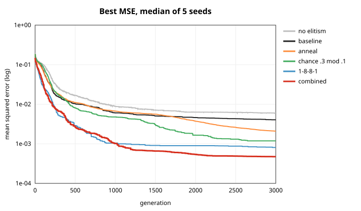
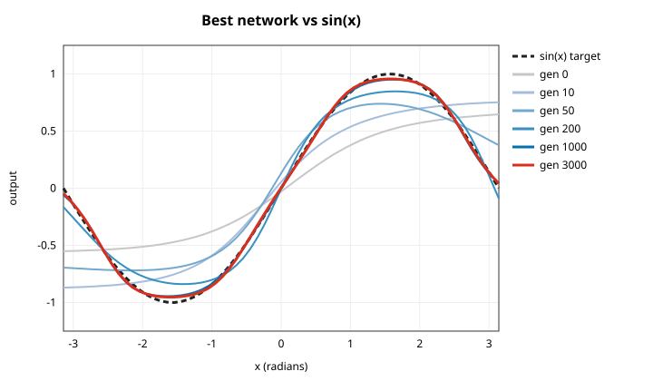

# Improving the sine model and its training

**Bottom line:** three changes together cut the final error **8.6×**, from a median MSE of **0.0041** to **0.00047** across 5 seeds. They also make results much more consistent from run to run, and the error drops below 0.01 about twice as fast:

1. **Add a second hidden layer** (1-8-1 → 1-8-8-1)
2. **Make smaller mutations, more often** (`chance=0.3 mod=0.1` instead of `0.1 / 0.2`)
3. **Shrink the mutation size over the run** (annealing from `mod` to `mod/20`)

```bash
./run 1 hidden=8,8 chance=0.3 mod=0.1 anneal=1
```

Elitism (keeping the best network every generation) also matters: turning it off makes results 1.5× worse. `trainer_3_0` doesn't use it yet.

Network size isn't the limit. Gradient descent on the *same* 1-8-1 network reaches **0.00004**, about 100× lower than evolution achieves.



---

## How this was tested

- **Task:** fit `sin(x)` at 64 evenly spaced points on `[-π, π]`. The input is scaled to `x/π`, and the score is mean squared error (lower is better).
- **Trainer:** `main.cpp` on this branch. It's the same evolutionary loop as `trainer_3_0` (evaluate, binary tournament to keep 50 of 100, refill with mutated copies), with the fitness reset bug fixed and elitism on by default.
- **Each configuration** ran for 3,000 generations with a population of 100, for seeds 1–5. Runs are deterministic per seed. The baseline with seed 1 matches the committed `sine-trainer` result exactly (0.00288885).
- **To reproduce everything:** `./experiments.sh` writes `outputs/experiments_summary.csv`, then `python plot.py` draws `outputs/experiments.svg`. The full sweep takes about 3.5 minutes with 22 parallel jobs.

## Results

Final best MSE over seeds 1–5, sorted from best to worst. "Gen to < 0.01" is the first generation where the best network's MSE dropped below 0.01, given as the median of the 5 seeds.

| Config | Settings | Median MSE | Range (min–max) | vs baseline | Gen to < 0.01 |
|---|---|---|---|---|---|
| **combo_anneal** | `hidden=8,8 chance=0.3 mod=0.1 anneal=1` | **0.00047** | 0.00039–0.00058 | **8.6× better** | 213 |
| combo | `hidden=8,8 chance=0.3 mod=0.1` | 0.00060 | 0.00051–0.00080 | 6.8× better | 233 |
| deep8x8 | `hidden=8,8` | 0.00081 | 0.00055–0.00179 | 5.0× better | 226 |
| small_steps_often | `chance=0.3 mod=0.1` | 0.00119 | 0.00081–0.00419 | 3.4× better | 428 |
| anneal | `anneal=1` | 0.00209 | 0.00146–0.00461 | 1.9× better | 614 |
| hidden16 | `hidden=16` | 0.00272 | 0.00157–0.00554 | 1.5× better | 389 |
| gauss_anneal | `mut=gauss mod=0.3 anneal=1` | 0.00324 | 0.00132–0.00574 | 1.3× better | 492 |
| baseline | defaults: 1-8-1, `chance=0.1 mod=0.2`, elite | 0.00405 | 0.00154–0.00609 | 1.0× | 536 |
| gauss | `mut=gauss mod=0.1` | 0.00511 | 0.00302–0.00546 | 1.3× worse | 514 |
| pop200_gens1500 | `pop=200 gens=1500` | 0.00528 | 0.00146–0.00709 | 1.3× worse | 500 |
| big_steps | `mod=0.5` | 0.00550 | 0.00130–0.00656 | 1.4× worse | 514 |
| hidden4 | `hidden=4` | 0.00551 | 0.00382–0.00728 | 1.4× worse | 872 |
| no_elite | `elite=0` | 0.00595 | 0.00414–0.00626 | 1.5× worse | 866 |

**Reference, not evolution:** `backprop_baseline.py` trains the same 1-8-1 tanh network with gradient descent (Adam, learning rate 0.01).

| Training | Median MSE | Epoch to < 0.01 (median) | Time (pure Python) |
|---|---|---|---|
| 3,000 epochs | 0.00122 | 951 | ~1.6 s per seed |
| 20,000 epochs | **0.000038** | 951 | ~19 s per seed |

<p align="center">
  
  
</p>

*Left: baseline, seed 1 (final MSE 0.0029). Right: combined settings, seed 1 (final MSE 0.00057).*

---

## What helped, and why

### 1. A second hidden layer: 5× better
`hidden=8,8` was the largest single improvement. It also tightened the spread across seeds: the worst seed scored 0.0018, versus 0.0061 for the baseline. The sine curve needs a fairly precise S-shape at each end. Two layers of `tanh` can build that from simple pieces, while one layer of 8 nodes has to get every weight nearly exact.

**Cost:** 108 weights instead of 27, so each evaluation takes roughly 2.5–4× longer (see caveats). Widening to one layer of 16 helped much less (1.5×), so the gain comes from depth, not just more weights.

### 2. Smaller, more frequent mutations: 3.4× better
Each child gets about 3× more weight changes, each about half the size. Late in training, every weight needs fine adjustment, and changing several weights a little at a time explores better than changing one weight a lot. Bigger steps alone (`mod=0.5`) made results worse.

### 3. Annealing the step size: 1.9× better, and it stacks
Big steps early on find the right general shape, and small steps later fine-tune it. Adding annealing to the combined settings improved them further, from 0.00060 to 0.00047. This is the same idea as lowering the learning rate during gradient descent.

### 4. Elitism: keep it
Without elitism, results are 1.5× worse and reaching 0.01 takes 60% more generations. The best network can lose a tournament or never get picked, and then its progress is lost. **`trainer_3_0` has no elitism** and would likely benefit from it too. The change is small: put `best_network` into the next population in `prune()`.

## What didn't help

- **Gaussian mutation** (`mut=gauss`). It was slightly worse than the current uniform-difference step, and annealing it helped less than annealing the uniform step. The current `Network::mutate` step shape is fine.
- **Bigger population, fewer generations** (`pop=200 gens=1500`, the same total work). It was worse. On this task, more generations beat a bigger population.
- **Fewer hidden nodes** (`hidden=4`). It was worse and slower to converge, so 4 nodes is too few for a full sine period.

---

## Recommendations, in order

1. **Use the combined settings** (`hidden=8,8 chance=0.3 mod=0.1 anneal=1`) as the new defaults for the sine trainer. *Measured: 8.6×.*
2. **Add elitism to `trainer_3_0`** (cart balance). Here, removing elitism made results 1.5× worse, so `trainer_3_0` very likely loses progress the same way. *Not tested on cart balance.*
3. **Try a gradient-based finishing step.** Gradient descent reaches about 100× lower error on the same network. Evolution is good at finding the right region and gradients are good at fine-tuning, so a hybrid would get the best of both: evolve for a few hundred generations, then fine-tune the best network with backprop. This needs a backward pass added to `Network`. Evolution is still the right tool for cart balance, which has no per-step target to compute gradients against. *Not built yet.*
4. **Speed up `Network::cycle`.** Every forward pass allocates several `std::vector`s per layer. Training the 1-8-1 network does about 19 million forward passes in ~35 s, or about 1.8 µs each. Computing in place with pre-allocated buffers should be much faster, which would make deeper networks and longer runs cheaper. *Not measured.*
5. **Small cleanups found along the way:** each node has a weight into the next layer's bias node that has no effect (2 of 27 weights in the 1-8-1 network, 11 of 108 in 1-8-8-1), and `weight_gen_min/max` are never used.

## Caveats

- **5 seeds per configuration on one task.** The large effects (depth, mutation settings, combined settings, elitism) are consistent across seeds. Smaller ones, like `gauss` versus baseline, are within the noise.
- **Times are rough.** All 65 runs shared a 24-core machine (22 at a time), so the timing columns in `experiments_summary.csv` reflect contention. A single baseline run alone takes about 35 s.
- **The comparisons are per generation, not per CPU second.** Deeper networks cost more per generation. Even so, the combined settings reach the baseline's final error (0.0041) by generation 394 (median; 305–833 across seeds), while the baseline needs all 3,000. Given the 2.5–4× per-generation cost, they should still finish ahead, but this wasn't timed head-to-head.
